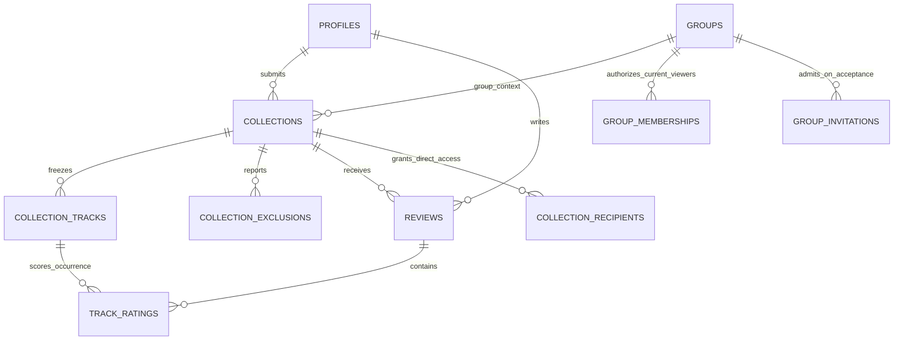

# Data Model: Private Playlists, Albums and Group Reviews

**Date**: 2026-11-20 | **Status**: Current Phase 1 design, not executed migrations.
**Authority**: [spec.md](spec.md), [plan.md](plan.md), constitution v4.0.0.
**Source decision**: VIP connected playlists; Normal/VIP catalog albums capped at the
first 100 source positions. No non-linked playlist importer.

## Identity and storage conventions

Use Supabase PostgreSQL 17, UUID primary identities, UTC timestamptz and versioned SQL
migrations for tables, indexes, constraints, functions, grants, RLS, publications and jobs.
Auth users/sessions remain managed; do not alter their structure or add a competing
identity/session registry. Logical session UUID bindings must not prevent native logout
deleting auth.sessions rows.

A collection is one context-specific share, not a global Spotify resource. Repeated shares
and direct/group shares never merge their reviews. Reviews hold current manual feedback;
track_ratings hold current per-occurrence scores/comments. No persisted average, rank,
completion flag or duplicate aggregate tables.

Physical collection names replace the old planned playlist-only names. There are no
application migrations implemented here; first migrations should create this schema
directly. If an actual shared database already exists, inspect its versioned history and
write forward migrations instead of assuming it can be renamed or recreated.

## Identity normalization and comparison

Canonicalization is one trusted SQL policy used by complete_profile, search_members,
invitation issuance/redemption and operator bootstrap. Client/Node validation can give
early feedback but cannot supply normalized_username or override the stored key.
Generate request digests from these canonical semantic values. Keep email comparison
separate from username search and never expose recipient_email in discovery.

### Username canonicalization

1. Accept a bare ASCII alphanumeric handle or one leading ASCII @. Strip at most that
   single prefix. Reject an empty result for setup/bootstrap; a search with empty input
   or a lone @ returns no rows. Do not trim or collapse whitespace in username input.
2. Require the entire remaining string to consist only of ASCII A–Z, a–z and 0–9.
   Reject all other code points, including underscores, whitespace at any position,
   line endings, accents, combining marks, emoji, fullwidth letters and embedded/repeated
   @. Never remove invalid characters, transliterate or perform Unicode normalization
   before validation. ASCII-case conversion is the only identifier transformation.
3. Map ASCII A–Z to a–z using a fixed mapping, independent of database/default locale.
   Store the bare lowercase result in profiles.username and profiles.normalized_username,
   with bytewise pg_catalog."C" collation. SQL CHECKs require both fields to be nonempty,
   entirely ASCII alphanumeric lowercase and equal. A unique constraint on the key
   arbitrates concurrent setup; no caller supplies the derived key. The retained key
   field introduces no second spelling, display-name concept or username-change flow.
4. Literal substring search applies the same prefix/validation/case policy to its query
   and compares canonical text using strpos, never unescaped LIKE/ILIKE patterns. Only
   activated identities may be returned. Selection and authorization remain UUID-based.
5. DTOs return the bare canonical username. Shared UI presentation prepends exactly one
   @, including discovery, account, feed, review and historical author labels. Do not
   persist a decorated duplicate or pass @-labels as authorization identifiers.

The owner-approved ASCII handle rule supersedes the earlier printable-Unicode proposal;
no pg_c_utf8 collation or Unicode username normalization is needed. The spec.md examples,
whole-string rejection (including trailing line endings), canonicalization idempotence,
prefix equivalence and concurrent uniqueness must be verified in application and SQL
tests. If preexisting nonconforming profiles are ever found, resolve them explicitly
through a versioned migration; never silently strip/merge identities or change their UUIDs.

### Email canonicalization

Trim only boundary characters from the explicit email White_Space set: U+0009–U+000D,
U+0020, U+0085, U+00A0, U+1680, U+2000–U+200A, U+2028, U+2029, U+202F, U+205F
and U+3000. This email-only trimming rule does not apply to usernames. Reject remaining
non-ASCII characters, internal whitespace, multiple addresses, display names/comments,
quoted local parts, IP-literal domains and malformed ASCII mailbox syntax. Use the exact
allowed local/domain characters and byte limits in spec.md. Lowercase A–Z to a–z in both
parts using a fixed ASCII mapping (not the server's default locale). Store only canonical
recipient_email and compare bytewise. Do not apply Unicode normalization, IDNA conversion,
accent removal or provider-specific alias folding. ASCII Punycode domain labels are
validated as supplied; raw Unicode addresses/domains are rejected with a clear error.

Apply the policy before Auth signup/signin/recovery requests and invitation SMTP envelope
construction. Revalidate and canonicalize the current verified auth.users.email inside
redemption under the native actor lock; an unsupported address fails closed, without
changing its identity to make it match. Auth lowercases email today; verify this contract
against the deployed Auth version, not only a browser preview or JWT claim. Plus tags and
dots remain significant even when a mail provider delivers them to the same inbox.

The signup/search/comparison examples in spec.md are required fixture vectors. Email
normalization does not authorize discovering an account by email or changing its email.

## Canonical entities and fields

The following 23 entities and 185 fields fix SQL names/types for subsequent tasks.
All non-NULL fields are required unless explicitly described otherwise. All timestamps
use UTC timestamptz; text enums require CHECKs or equivalent versioned SQL types.
Public means Data API schema, not public internet visibility: every table has RLS.
Private tables are not exposed through Data API. Reference relationships and mutation
checks below apply in addition to row constraints.

### public.profiles

| Field | Type / row constraint |
| --- | --- |
| `profiles.id` | uuid PK, FK auth.users |
| `profiles.username` | text COLLATE "C", nonempty bare lowercase ASCII alphanumeric handle |
| `profiles.normalized_username` | text COLLATE "C" UNIQUE, trusted derived key equal to username |
| `profiles.created_at` | timestamptz |

Expose only activated identity fields to discovery. Same normalization for setup/search; select identity by UUID, never email. Initial setup
creates the profile before activation; discovery filters active targets, while authorized
history may expose the minimal first-party identity of its authors.

### public.collections

| Field | Type / row constraint |
| --- | --- |
| `collections.id` | uuid PK |
| `collections.sender_id` | uuid FK profiles |
| `collections.collection_kind` | text: playlist / album |
| `collections.source_mode` | text: connected_playlist / catalog_album |
| `collections.sharing_kind` | text: direct / group |
| `collections.group_id` | uuid NULL FK groups |
| `collections.import_scope` | text: full / first_100 |
| `collections.captured_item_count` | integer >0 |
| `collections.rateable_count` | integer >0 |
| `collections.created_at` | timestamptz |
| `collections.publication_operation_id` | uuid |

UNIQUE(sender_id, publication_operation_id). group_id present iff sharing_kind=group. rateable_count <= captured_item_count. Connected source is playlist/full. Catalog source is album, captures <=100; full only when entire original scope is established, otherwise first_100. Immutable publication composition/context.

### public.collection_recipients

| Field | Type / row constraint |
| --- | --- |
| `collection_recipients.collection_id` | uuid FK collections |
| `collection_recipients.recipient_id` | uuid FK profiles |
| `collection_recipients.created_at` | timestamptz |

PK(collection_id,recipient_id); direct grants only. Existing grants are independent of follows; sender cannot review.

### public.collection_tracks

| Field | Type / row constraint |
| --- | --- |
| `collection_tracks.id` | uuid PK |
| `collection_tracks.collection_id` | uuid FK collections |
| `collection_tracks.original_position` | integer >0 |
| `collection_tracks.evaluation_position` | integer >0 |

UNIQUE(collection_id,original_position), UNIQUE(collection_id,evaluation_position), UNIQUE(id,collection_id). Duplicate songs have distinct internal occurrence IDs.

### public.collection_exclusions

| Field | Type / row constraint |
| --- | --- |
| `collection_exclusions.collection_id` | uuid FK collections |
| `collection_exclusions.original_position` | integer >0 |
| `collection_exclusions.reason_code` | text: episode / local_item / unavailable / unidentified / unsupported |

PK(collection_id,original_position). No excluded provider payload. Publication enforces exact coverage with tracks, without overlap; survives staging cleanup.

### public.reviews

| Field | Type / row constraint |
| --- | --- |
| `reviews.id` | uuid PK |
| `reviews.collection_id` | uuid FK collections |
| `reviews.reviewer_id` | uuid FK profiles |
| `reviews.general_half_points` | smallint NULL, 0..10 |
| `reviews.favorite_occurrence_id` | uuid NULL |
| `reviews.least_liked_occurrence_id` | uuid NULL |
| `reviews.general_version` | bigint >=0 DEFAULT 0 |
| `reviews.general_updated_at` | timestamptz NULL |
| `reviews.created_at` | timestamptz |
| `reviews.updated_at` | timestamptz |

UNIQUE(collection_id,reviewer_id), UNIQUE(id,collection_id). Composite choice FKs reference collection_tracks(id,collection_id), MATCH SIMPLE. Nonnull choices differ. First authorized track/general/choice write creates review; actor differs from sender. Track edits do not advance general_version.

### public.track_ratings

| Field | Type / row constraint |
| --- | --- |
| `track_ratings.review_id` | uuid |
| `track_ratings.collection_id` | uuid |
| `track_ratings.occurrence_id` | uuid |
| `track_ratings.score_half_points` | smallint, 0..10 |
| `track_ratings.comment` | text NULL |
| `track_ratings.version` | bigint >=1 |
| `track_ratings.updated_at` | timestamptz |

PK(review_id,occurrence_id); composite FKs (review_id,collection_id)->reviews and (occurrence_id,collection_id)->collection_tracks. A comment accompanies a score; no invented product length limit.

### public.follows

| Field | Type / row constraint |
| --- | --- |
| `follows.follower_id` | uuid FK profiles |
| `follows.followed_id` | uuid FK profiles |
| `follows.created_at` | timestamptz |

PK(follower_id,followed_id); own directional list. A repeated follow is idempotent; unfollow preserves reverse follows, groups, grants and feedback.

### public.groups

| Field | Type / row constraint |
| --- | --- |
| `groups.id` | uuid PK |
| `groups.creator_id` | uuid FK profiles |
| `groups.name` | text |
| `groups.created_at` | timestamptz |

Creator membership created atomically. Group creator is distinct from administrator authority; any current member may post an eligible source.

### public.group_invitations

| Field | Type / row constraint |
| --- | --- |
| `group_invitations.id` | uuid PK |
| `group_invitations.group_id` | uuid FK groups |
| `group_invitations.invitee_id` | uuid FK profiles |
| `group_invitations.issuer_id` | uuid FK profiles |
| `group_invitations.status` | text: pending / accepted / canceled |
| `group_invitations.created_at` | timestamptz |
| `group_invitations.accepted_at` | timestamptz NULL |
| `group_invitations.canceled_at` | timestamptz NULL |
| `group_invitations.operation_id` | uuid |

UNIQUE(issuer_id,operation_id); partial unique pending(group_id,invitee_id). Creator follows active target at issuance. Only target accepts; no account-code expiry inherited.

### public.group_memberships

| Field | Type / row constraint |
| --- | --- |
| `group_memberships.group_id` | uuid FK groups |
| `group_memberships.participant_id` | uuid FK profiles |
| `group_memberships.membership_kind` | text: creator / member |
| `group_memberships.status` | text: current / removed |
| `group_memberships.joined_at` | timestamptz |
| `group_memberships.removed_at` | timestamptz NULL |

PK(group_id,participant_id); current iff removed_at NULL. Remove retains feedback, cancels pending invitations and revokes entire group history. New pending invitation needed for readmission.

### public.collection_metadata

| Field | Type / row constraint |
| --- | --- |
| `collection_metadata.collection_id` | uuid PK FK collections |
| `collection_metadata.reference_id` | uuid UNIQUE FK private.spotify_references |
| `collection_metadata.title` | text |
| `collection_metadata.artist_display` | text NULL |
| `collection_metadata.source_creator_display` | text NULL |
| `collection_metadata.source_url` | text HTTPS |
| `collection_metadata.artwork_url` | text HTTPS NULL |
| `collection_metadata.release_type` | text NULL |
| `collection_metadata.release_date` | text NULL |
| `collection_metadata.release_date_precision` | text NULL: year / month / day |
| `collection_metadata.source_total_at_import` | integer >=0 NULL |
| `collection_metadata.source_has_more_at_import` | boolean NULL |
| `collection_metadata.fetched_at` | timestamptz |
| `collection_metadata.expires_at` | timestamptz |

Purgeable provider data; original import total is not overwritten with later totals. Source attribution/unaltered artwork. Missing fields stay absent; freshness <=24h. Album release precision preserved.

### public.track_metadata

| Field | Type / row constraint |
| --- | --- |
| `track_metadata.occurrence_id` | uuid PK FK collection_tracks |
| `track_metadata.reference_id` | uuid UNIQUE FK private.spotify_references |
| `track_metadata.title` | text |
| `track_metadata.artist_display` | text NULL |
| `track_metadata.source_url` | text HTTPS |
| `track_metadata.duration_ms` | integer >=0 NULL |
| `track_metadata.disc_number` | integer >0 NULL |
| `track_metadata.track_number` | integer >0 NULL |
| `track_metadata.fetched_at` | timestamptz |
| `track_metadata.expires_at` | timestamptz |

Purgeable metadata, current audience plus source eligibility/freshness. No matching a changed list by position/title. Metadata absence never alters occurrence identity/progress.

### public.participant_sync

| Field | Type / row constraint |
| --- | --- |
| `participant_sync.participant_id` | uuid PK FK profiles |
| `participant_sync.revision` | bigint >=0 |
| `participant_sync.updated_at` | timestamptz |

Only own live activated SELECT/event access. Publish UPDATE only, containing no private context/payload. No authenticated raw mutation.

### private.account_access

| Field | Type / row constraint |
| --- | --- |
| `account_access.user_id` | uuid PK FK auth.users |
| `account_access.state` | text: inactive / active |
| `account_access.activated_at` | timestamptz NULL |
| `account_access.application_role` | text: administrator / common |
| `account_access.import_tier` | text: normal / vip DEFAULT normal |
| `account_access.authority_version` | bigint >=1 |
| `account_access.updated_at` | timestamptz |

Trusted authority only; role and import tier orthogonal. Every authority change advances version and applies required native/provider revocation. Lock row on private writes; administrator alone grants no content or Spotify permission.

### private.activation_invitations

| Field | Type / row constraint |
| --- | --- |
| `activation_invitations.id` | uuid PK |
| `activation_invitations.issuer_id` | uuid FK profiles |
| `activation_invitations.recipient_email` | text COLLATE "C", canonical ASCII mailbox per identity policy |
| `activation_invitations.code_digest` | bytea UNIQUE, exactly 32 bytes |
| `activation_invitations.created_at` | timestamptz |
| `activation_invitations.expires_at` | timestamptz |
| `activation_invitations.consumed_by` | uuid NULL FK profiles |
| `activation_invitations.consumed_at` | timestamptz NULL |
| `activation_invitations.issuance_operation_id` | uuid |
| `activation_invitations.send_attempt_id` | uuid UNIQUE |
| `activation_invitations.send_status` | text: attempting / smtp_accepted / failed / unknown |
| `activation_invitations.send_started_at` | timestamptz |
| `activation_invitations.send_deadline_at` | timestamptz |
| `activation_invitations.send_finished_at` | timestamptz NULL |
| `activation_invitations.send_outcome_code` | text NULL, exact safe enum in delivery outcome mapping below |
| `activation_invitations.smtp_message_id` | text NULL, server-generated identifier |

UNIQUE(issuer_id,issuance_operation_id). Expiry exactly created_at +24 elapsed hours; consumed fields both null or both present. Send deadline created+15 seconds. Claim one attempt before SMTP; no raw code/body/link. Redemption and sending are separate states.

### Delivery outcome mapping

send_status is the four-value lifecycle state; send_outcome_code is a finite, sanitized
reason, not an SMTP response number, arbitrary error string or activation state.
The following table exhausts allowed persisted pairs, including NULL. Enforce it with
a SQL CHECK and validate the same union at the Node/RPC boundary.
The CHECK must explicitly test NULL/non-NULL code and timestamp branches; SQL UNKNOWN
must not accidentally admit a terminal status with a NULL reason/finished time.

| send_status | Allowed send_outcome_code | Meaning / classifier evidence |
| --- | --- | --- |
| attempting | NULL only | Sole attempt claimed; no durable terminal outcome yet. |
| smtp_accepted | SMTP_ACCEPTED | Nodemailer completed sending, sole intended recipient accepted and final positive DATA acknowledgement observed. RCPT TO acceptance alone is insufficient. |
| failed | SMTP_AUTH_FAILED | EAUTH / ENOAUTH / EOAUTH2 at AUTH, before message submission. |
| failed | SMTP_TLS_FAILED | ETLS / EREQUIRETLS or certificate/required-STARTTLS failure before message submission; never fall back to unverified/plaintext transport. |
| failed | SMTP_CONNECTION_FAILED | EDNS, ECONNREFUSED or ECONNECTION / ESOCKET with proof no complete message could have been submitted. |
| failed | SMTP_RECIPIENT_REJECTED | Sole RCPT TO receives definitive 5xx rejection, e.g. 550/551/553. An EENVELOPE label alone is insufficient. |
| failed | SMTP_TEMPORARY_REJECTION | Explicit transaction 4xx rejection, e.g. 421/450/451/452, unless the more specific AUTH/TLS rule applies. |
| failed | SMTP_PERMANENT_REJECTION | Other explicit transaction 5xx rejection, e.g. MAIL FROM or final DATA 550/552/554, excluding the more specific rules above. |
| failed | SMTP_LOCAL_FAILURE | Validated local configuration/envelope/message/stream failure with proof submission did not complete; includes no-send ECONFIG/EENVELOPE/EMESSAGE/ESTREAM/EFILEACCESS/EURLACCESS cases. |
| failed | SMTP_TIMEOUT_BEFORE_ACCEPTANCE | Deadline, ETIMEDOUT or EABORT with proof submission could not have completed, such as connect/greeting/TLS timeout before DATA. |
| unknown | SMTP_ACKNOWLEDGEMENT_LOST | Timeout, EABORT, ECONNECTION/ESOCKET, stream/protocol error or unexpected failure after submission might have completed, without a definitive final reply. |
| unknown | SMTP_OUTCOME_UNCONFIRMED | Process stopped, first SQL code response lost, or outcome persistence was not confirmed; no trustworthy terminal evidence is available. |

There are exactly 11 non-NULL codes. Classify by positive final acknowledgement or a
definitive rejection first; apply the specific AUTH/TLS/recipient rules before generic
response classes. Otherwise use proven pre-submission evidence; when the stage cannot
be established, choose unknown, not failed. An error.code alone never proves whether
the email was accepted. A later QUIT/socket error cannot overturn observed final DATA
acceptance. A 4xx at RCPT uses temporary rejection, not permanent recipient rejection.
An unsupported/unexpected SMTP reply (including a 503) is not automatically a permanent
rejection: use proven no-submission/local-failure evidence or unknown as applicable.

For a live attempting row, send_finished_at and send_outcome_code are NULL. A persisted
terminal pair has non-NULL send_finished_at. Accepted/failed outcomes are immutable;
an attested definitive result may refine unknown for the same send_attempt_id only.
smtp_message_id alone proves neither acceptance nor delivery and is never an outcome code.

If persistence fails, do not claim that an outcome code was stored. A stale attempting
row may still have NULL code/finished time: get_invitation_receipt projects the effective
pair unknown/SMTP_OUTCOME_UNCONFIRMED after its deadline, without inventing a send or
durable finalization. An already-claimed finalizer can later persist attested evidence.
Receipt DTOs use these effective pairs and expose no raw SMTP response, exception text,
credential, code/link or message body. No code authorizes automatic retry; an explicit
new issuance remains a separate invitation/operation and consumes the normal limits.

### private.activation_attempts

| Field | Type / row constraint |
| --- | --- |
| `activation_attempts.actor_id` | uuid FK auth.users |
| `activation_attempts.window_start` | timestamptz |
| `activation_attempts.attempts` | integer >=0 |

PK(actor_id,window_start). Initial 5 redemption attempts per authenticated account per 15-minute fixed window; denials commit counters. Expiry uses clock time after lock waits.

### private.operation_receipts

| Field | Type / row constraint |
| --- | --- |
| `operation_receipts.actor_id` | uuid FK auth.users |
| `operation_receipts.operation_id` | uuid |
| `operation_receipts.kind` | text |
| `operation_receipts.request_digest` | bytea, exactly 32 bytes |
| `operation_receipts.result_id` | uuid NULL |
| `operation_receipts.status` | text, safe domain outcome |
| `operation_receipts.created_at` | timestamptz |

PK(actor_id,operation_id). Canonical validated request digest; conflicting key reuse rejected. No raw secret/DTO archive. Authorize replay before returning result. Thin receipts retained while needed for replay barriers; cleanup cannot permit duplicate old operations.

Reserve kind=initial_administrator_bootstrap for the operator operation and add a unique
partial index on kind for that value. One durable receipt identifies the installation's
initial administrator, with result_id equal to that profile UUID; never expire/delete
this receipt. Bootstrap is not an authenticated business RPC or caller-selected operation.

### private.spotify_connections

| Field | Type / row constraint |
| --- | --- |
| `spotify_connections.id` | uuid PK |
| `spotify_connections.owner_id` | uuid UNIQUE FK profiles |
| `spotify_connections.account_id` | text NULL |
| `spotify_connections.encrypted_token_envelope` | bytea NULL |
| `spotify_connections.key_id` | text NULL |
| `spotify_connections.status` | text: pending / connected / reauthorization_required / disconnected |
| `spotify_connections.grant_generation` | bigint >=1 |
| `spotify_connections.access_expires_at` | timestamptz NULL |
| `spotify_connections.refresh_expires_at` | timestamptz NULL |
| `spotify_connections.last_authorized_at` | timestamptz NULL |
| `spotify_connections.refresh_lease_id` | uuid NULL |
| `spotify_connections.refresh_lease_until` | timestamptz NULL |

Connected requires required account/token fields. Server-only authenticated encryption with environment key. Generation advances on disconnect/replacement; downgrade invalidates relevant authority/grants. Disconnected tombstone has internal first-party state only after provider identifiers/credentials are purged.

### private.spotify_oauth_attempts

| Field | Type / row constraint |
| --- | --- |
| `spotify_oauth_attempts.state_digest` | bytea PK, exactly 32 bytes |
| `spotify_oauth_attempts.owner_id` | uuid FK profiles |
| `spotify_oauth_attempts.auth_session_id` | uuid logical native-session binding |
| `spotify_oauth_attempts.connection_id` | uuid FK spotify_connections |
| `spotify_oauth_attempts.encrypted_pkce_verifier` | bytea |
| `spotify_oauth_attempts.expires_at` | timestamptz |
| `spotify_oauth_attempts.consumed_at` | timestamptz NULL |
| `spotify_oauth_attempts.grant_generation` | bigint >=1 |
| `spotify_oauth_attempts.authority_version` | bigint >=1 |

One-use 10-minute PKCE state bound to live initiating session, VIP authority/version and grant generation. No FK blocking native auth.sessions deletion; erase expired/consumed secret material.

### private.collection_imports

| Field | Type / row constraint |
| --- | --- |
| `collection_imports.id` | uuid PK |
| `collection_imports.actor_id` | uuid FK profiles |
| `collection_imports.actor_session_id` | uuid logical native-session binding |
| `collection_imports.operation_id` | uuid |
| `collection_imports.request_digest` | bytea, exactly 32 bytes |
| `collection_imports.collection_kind` | text: playlist / album |
| `collection_imports.source_mode` | text: connected_playlist / catalog_album |
| `collection_imports.requested_scope` | text: full / first_100 |
| `collection_imports.target_audience` | jsonb validated direct recipient UUIDs OR group UUID |
| `collection_imports.provider_resource_id` | text |
| `collection_imports.connection_id` | uuid NULL FK spotify_connections |
| `collection_imports.grant_generation` | bigint NULL |
| `collection_imports.authority_version` | bigint >=1 |
| `collection_imports.status` | text: collecting / ready / failed / published |
| `collection_imports.initial_snapshot` | text NULL |
| `collection_imports.next_offset` | integer >=0 |
| `collection_imports.restart_count` | integer 0..2 |
| `collection_imports.source_total_at_import` | integer >=0 NULL |
| `collection_imports.source_has_more_at_import` | boolean NULL |
| `collection_imports.captured_item_count` | integer >=0 |
| `collection_imports.rateable_count` | integer >=0 |
| `collection_imports.attested_at` | timestamptz NULL |
| `collection_imports.expires_at` | timestamptz |
| `collection_imports.published_collection_id` | uuid NULL FK collections |

UNIQUE(actor_id,operation_id). Connected playlist/full requires own connection/generation and snapshot; catalog album/first_100 requires both personal fields NULL and no snapshot. Stage TTL 24h. Trusted server attestation, no browser-authored tracks; counts/order/coverage checked at publication.

### private.import_items

| Field | Type / row constraint |
| --- | --- |
| `import_items.import_id` | uuid FK collection_imports |
| `import_items.original_position` | integer >0 |
| `import_items.item_kind` | text |
| `import_items.eligible` | boolean |
| `import_items.exclusion_reason` | text NULL: episode / local_item / unavailable / unidentified / unsupported; NULL iff eligible=true |
| `import_items.provider_fields` | jsonb NULL, minimal validated metadata |

PK(import_id,original_position). An eligible item requires a valid track identity and a
NULL exclusion_reason. An ineligible item requires a non-NULL exclusion_reason from the
exact same set as [collection_exclusions.reason_code](#publiccollection_exclusions):
episode, local_item, unavailable, unidentified or unsupported. No other code is permitted.
Use explicit IS NULL/IS NOT NULL branches in SQL CHECKs so SQL UNKNOWN cannot admit an
invalid eligible/reason combination. Publication copies the staged reason unchanged to
collection_exclusions.reason_code for the same original position; no spelling alias or
silent fallback is allowed. Reject unknown reason values and inconsistent eligibility
before a stage can be ready or published. No arbitrary provider payload archive. Only
the first 100 album source positions are captured before exclusions.

### private.spotify_references

| Field | Type / row constraint |
| --- | --- |
| `spotify_references.id` | uuid PK |
| `spotify_references.collection_id` | uuid FK collections |
| `spotify_references.occurrence_id` | uuid NULL |
| `spotify_references.source_mode` | text: connected_playlist / catalog_album |
| `spotify_references.connection_id` | uuid NULL FK spotify_connections |
| `spotify_references.grant_generation` | bigint NULL |
| `spotify_references.provider_resource_id` | text |
| `spotify_references.snapshot_id` | text NULL |
| `spotify_references.last_validated_at` | timestamptz |
| `spotify_references.revoked_at` | timestamptz NULL |

Connected requires connection/current generation; catalog requires both NULL and snapshot NULL. Composite occurrence FK binds same collection. One collection reference where occurrence NULL; unique occurrence reference otherwise. Purge references cascades only provider metadata, never immutable collection/feedback.

## Cross-row invariants and indexes

Publish only when every captured source position is represented exactly once by an
eligible occurrence or exclusion, all evaluation positions are contiguous, and the
stored counts agree. First-100 applies before exclusions. A catalog source of 60 items
may be marked full only after complete coverage is established; a larger/known-continuing
source is first_100. The source mode stays catalog_album in both cases. An unknown
original total never becomes a fabricated count or a claim of full coverage.

Use composite FKs for both rating relationships and both review choices:
review/collection and occurrence/collection. A nullable favorite/least-liked reference
uses MATCH SIMPLE. Reject a foreign occurrence and reject equal nonnull choices.
Sender exclusion, active reviewer eligibility, source coupling and captured coverage
are checked in the restricted mutation transaction; do not implement cross-table CHECK
queries. Group removal never cascades to reviews.

Index all FK/authorization paths: collection(sender,created_at,id), collection(group_id,
created_at,id), recipient(recipient_id,collection_id), review(collection_id,reviewer_id),
rating(review_id,occurrence_id), membership(participant_id,status,group_id), follow
(follower_id,followed_id), pending invitations by target/group, and source references by
connection/generation. Index invitation issuer/time and creation time for serialized
mail limits, operation receipt PKs, stage actor/expiry, and metadata expiry. No speculative
global search, recommendation or separate ranking index/service.

## RLS, SQL privileges and permissions

| Resource/action | Required trusted condition |
| --- | --- |
| Every private read/write/event | Signed valid-time user JWT, matching live native session and active account_access. |
| Own inactive setup/status/activation | Genuine current subject, own minimal fields and explicit valid-code redemption only. |
| Discovery/follow list | Activated identity-only results; no email, role, provider ID or private feedback. |
| Issue application invitation | Live activated administrator, serialized issuance limits. |
| Connect/import playlist | VIP plus own current provider authorization/generation; admin alone is insufficient. |
| Import album | Active participant, trusted catalog attestation, no personal connection/generation. |
| Direct collection/occurrences | Sender or explicit recipient for that share. |
| Direct review/general/choices/summary | Sender and that individual reviewer; co-recipient reads/aggregates denied. |
| Group content/results/ranking | Current group member, irrespective of submission/review authorship. |
| Write feedback | Current eligible recipient/member, actor=reviewer, actor != sender. |
| Group invite/remove | Creator only, followed/active target for issuance. |
| Realtime | Own participant_sync row with live active session, not a subscription filter alone. |
| Provider metadata | Underlying audience plus unrevoked source reference, fresh cache and, for connected origin, current connected generation. |

Authenticated callers receive safe SELECT and RPC execution only, never raw table DML.
Public SECURITY INVOKER wrappers call private implementations owned by a dedicated
NOLOGIN/NOBYPASSRLS non-table-owner executor. Its narrow grants and RLS use the signed
request actor. Use empty search_path, qualified names and revoked default PUBLIC execute.
A narrowly privileged Auth helper returns current-actor facts only. It locks the actual
auth.sessions row FOR SHARE for writes and rechecks current time/activation. Ordinary
business DAL/actions use the user JWT; service-role never replaces RLS for feeds,
groups, reviews, aggregates or final publication.

A server-only privileged integration adapter is limited to encrypted provider grants,
trusted source staging, necessary lifecycle cleanup and
finalizing an already-claimed SMTP attempt. The SMTP finalizer cannot issue, activate,
extend expiry or resend; it records only the existing attempt's safe outcome even if
the original administrator session expires during network work. See
[database-rpc.md](contracts/database-rpc.md).

## Atomic state transitions and concurrency

Node calls integration helpers through narrow public integration_* RPC wrappers
executable only by service_role. The private schema stays unexposed, with no anonymous/
authenticated or generic privileged business endpoint. Ordinary business operations
continue using the current user JWT and RLS.

### Account and invitation lifecycle

Own initial setup lazily creates common/Normal inactive access if missing; an own-account
read treats absence as setup required. Only trusted operator maintenance assigns administrator/VIP.
Initial own username setup creates
profiles before activation; no generated username or public role claim is assumed.
Native verified email is not activation.
Under constitution v4.0.0, initial administrator bootstrap is the only invitation-free
activation. Create/select the identity through official Supabase Auth mechanisms and
complete email verification first; do not raw-insert managed auth.users, version a real
password/email in a migration, or auto-confirm an unverified mailbox to bypass ownership.
The operator supplies its exact Auth UUID and canonical username; import tier is Normal
unless explicitly assigned VIP. Administrator alone never implies VIP or Spotify access.

Run through a protected operator administration connection, not application service-role
integration wrappers. Serialize bootstrap with a fixed advisory gate and recheck the
verified native identity under lock. In one transaction create/reuse its inactive profile,
set active administrator authority/activated_at, initialize participant_sync and write the
unique installation bootstrap receipt. Reject a fresh bootstrap if any activated_at is
already present or another bootstrap receipt exists. Keep activated_at on later authority
deactivation; the receipt permanently closes bootstrap even if the admin is downgraded.
A same-UUID retry returns the prior receipt without changing password, username, tier,
authority or activation again; a different UUID is denied. Failed/unverified bootstrap
has no partial effects and creates/consumes no invitation or SMTP send claim.
No public initial-owner claim exists. Subsequent accounts activate by invitation before
trusted promotion. Recovery of existing authority is protected operator maintenance, not
reopening bootstrap or creating another invitation-free member. Backups/restores preserve
the receipt; a missing receipt with prior activated accounts is a closed, manual-recovery
condition, not permission to run fresh bootstrap.

Issuance generates 32 cryptographically random bytes in the trusted SQL routine, encodes
a URL-safe code and hashes the exact code with SHA-256. Return the raw code only in the
fresh issuing administrator RPC response to the Node sender; never persist it in a
receipt, log or replay. A lost first response leaves no recoverable raw code.

Issuance: live session -> active administrator -> serialized limits -> hash-only invitation
and operation receipt with one send claim -> commit -> bounded SMTP -> private outcome
finalizer. Hold no DB transaction during SMTP. Initial limits: 5 issuance operations per
administrator/hour and 20 per project/rolling 24h, counted conservatively even on failure.
A transaction-scoped global advisory lock serializes the project limit across administrators.
Same operation replays return receipt/status without generating/re-sending code.

Send status and its reason follow the exact delivery outcome mapping above. Status
starts attempting, then smtp_accepted, failed or unknown. Accepted means
the intended recipient's SMTP acceptance, not inbox arrival. A missed deadline/stale
attempt becomes unknown. A later attested definitive outcome may refine that same
unknown attempt, never cause another send. Explicit new issuance uses a new operation ID
and new deadline; it neither extends nor silently revokes an older invitation.

Explicit redemption authenticates, counts the attempt, locks the invitation, reads current
trusted verified target email under its actor-row lock and checks wall clock after waits.
Consumption and activation
commit together. Typed denials commit counters but not consumption. Five attempts/account/
15-minute fixed window initially; opening/preview/GET never consumes. Codes expire exactly
24 elapsed hours after issuance, including across daylight-saving boundaries.
An already active account cannot consume a new invitation through redemption. Failed login
never changes application activation, consumed_by/consumed_at or invitation expiry;
native authentication rate limits are separate from membership state.

### Lock ordering and authorization races

For activation, first lock the current actor's trusted auth.users row FOR SHARE so an
email change cannot race verified-email binding. Then use the common order:
native session -> account authority -> personal connection if applicable ->
operation-specific issuance advisory gate when issuing mail -> group -> invitation/
membership -> review/import/affected feedback -> sorted participant_sync UUIDs.
Each routine takes only relevant locks. Do not call back into an earlier lock stage.

Group create/invite/accept/remove takes group FOR UPDATE; posting/feedback takes group
FOR SHARE and the actor's current membership FOR SHARE. Removal updates membership
under the compatible exclusive lock. Return either a write ordered before removal or
an authorized denial, never a stale post-removal commit. Old accepted invitations cannot
readmit; new creator-issued pending invitations can. Pending invitations grant no content.

Authority changes lock account_access exclusively, increment authority_version and
invalidate affected personal authorization/staging. Native session revocation conflicts
with the session write lock. Never hold these locks while calling provider/SMTP HTTP/TCP.
Recheck stage/session/authority/generation after network work before publication.

### Imports and publication

Stages are collecting -> ready -> published, or failed. Continuations are actor/session/
operation-bound. Connected playlist requires VIP, same personal connection/generation,
stable before/after snapshot and all pages. Catalog album requires application-authenticated
attestation, requested_scope=first_100 and no invented playlist snapshot/personal grant.
At most two source pages per continuation; source-mode-specific progress makes retries
replace the same source positions rather than append duplicates. Maximum two restarts
on playlist snapshot change; further change reports failure.

Final user-JWT publication locks/revalidates the actor, audience and trusted stage, then
creates collection, occurrences/exclusions, direct grants, fresh source references/
metadata and revisions atomically. Staged browser payloads are never authoritative.
A repeated publication returns the same collection only after current access checks.

### Feedback and exact arithmetic

Create/find one parent review at the first track/general/choice write. Track replacement
uses expected version 0 for first score and the current track version afterward.
General score/choices use expected general_version; track-only edits do not advance it.
Concurrent first writes resolve through the unique parent and row lock. Authorize before
revealing conflicts/current values or returning an idempotent receipt.

Manual score is optional initially and may be replaced with 0..10 half-points; clearing
a recorded manual vote is not added. Omitted general fields preserve values. Choices are
optional; nullable choice edits may clear/change those optional selections atomically
under A-02/A-03. No-op payload need not create an empty review. Neither choice-only nor
comment-only writes change numeric means/progress.

Track mean = sum(half-points)/(2*rated_count), with null mean when count=0.
Group mean = sum(nonnull general half-points)/(2*contributing_count), including real zero.
Current viewer membership authorizes group results; do not filter retained review authors
by current membership. Direct shares never get co-recipient aggregates.

Use PostgreSQL numeric, cast the numerator to numeric(80,40) before division for ordering,
and compare before display rounding. Sequential ROW_NUMBER partitions by group and
collection kind, ordering unrounded mean DESC then immutable collection UUID ASC.
Round only display to two decimals with upward ties. Exactly three highlighted nullable
DTO slots plus positions four onward; no fake collections or stored rank rows.
Compute means/counts/positions in one authorized query snapshot. See
[HTTP contract](contracts/http-api.md) for decimal/version wire types.

### Revision fanout

Every confirmed mutation increments only currently authorized audience revisions.
Direct feedback touches sender/reviewer only; group feedback touches current members
because a score can reorder that group's ranking. Removal touches the removed actor
once; later group activity does not. Retained votes still count; actual lawful feedback
erasure must invalidate affected results. Revisions carry no private context identifiers.

## Provider lifecycle, migrations and recovery

Freeze first-party occurrence identities/order against ordinary provider composition
changes. Keep provider metadata/IDs/URLs/references purgeable. Freshness is at most 24 hours,
then revalidate the same identified source item or hide metadata; never substitute a
changed playlist's current position for a frozen occurrence.

Personal disconnect locks the connection, advances generation, invalidates OAuth/import/
refresh work and marks/purges applicable connected references/data, normally immediately,
within the existing five-day policy including controlled copies. Independently imported
catalog albums do not borrow personal grants and are not blanket-purged on a personal
disconnect. They retain their own revocation/freshness/erasure obligations. Relabeling
connected origin as catalog to retain data is forbidden. Retained feedback remains subject
to QC-005 association review, not automatically anonymous.

Version cleanup jobs in SQL (hourly pg_cron where supported) for expired staging/OAuth,
metadata and bounded attempts/job logs. Never delete replay barriers merely to meet a
TTL; thin operation records remain necessary. Free-project pauses may stop jobs, so
unavailable erasure/restoration needs an operator procedure.

Test empty-database rebuild and forward upgrade in isolation. Controlled encrypted
first-party exports omit provider credentials/payloads, native sessions and invitation
replay/activation state that could restore old rights. Restore must reconcile trusted
administrator/VIP authority, invalidate affected sessions, invitations and provider
generations before access resumes. Do not restore obsolete managed Auth internals or
resurrect consumed codes. No destructive migration, account deletion, group succession,
voluntary leave or public role-management UI is approved by this design.
