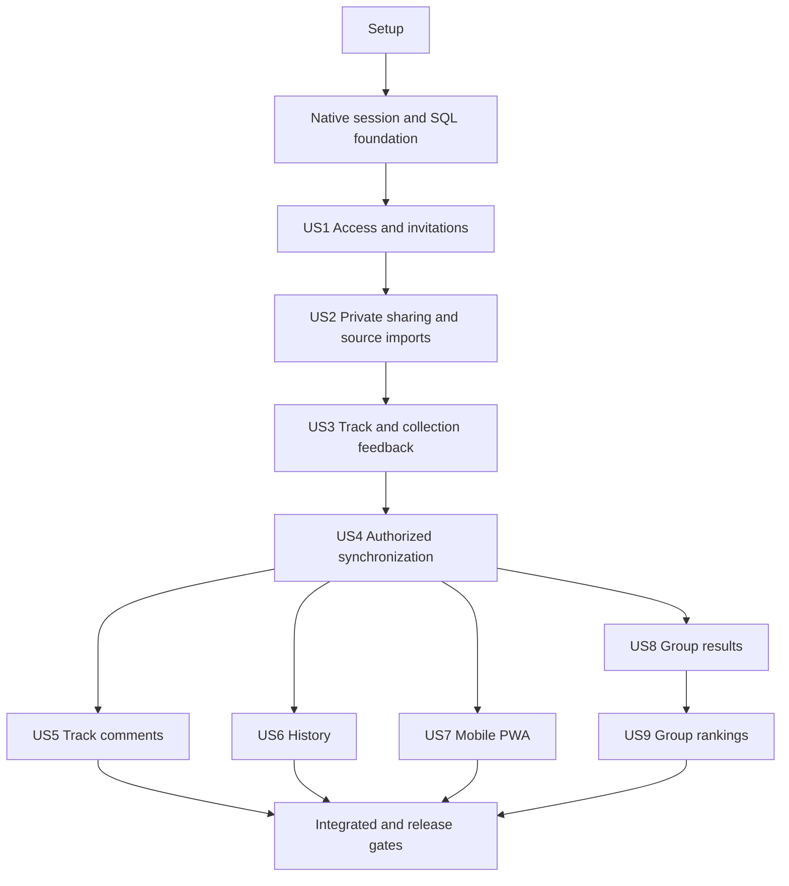

# Tasks: Mayonnaise — Private Playlist and Album Reviews

**Generated**: 2026-11-20
**Feature**: `specs/001-rate-playlists` | **Working branch**: `main`
**Input**: [spec.md](spec.md), [plan.md](plan.md), [research.md](research.md),
[data-model.md](data-model.md), [contracts/](contracts/), [quickstart.md](quickstart.md)
and [constitution v4.0.0](../../.specify/memory/constitution.md).

**Status**: Regenerated for the approved scope; all 136 tasks are unchecked.
This replaces the former 140-task list. IDs below are new execution references and are
not aliases for historical task IDs. No implementation, deployment or actual service
validation is performed by task generation.

**Tests**: Explicitly required by spec.md QC-002 and constitutional principles IV–VIII.
Write each story's listed tests first, record the expected initial failure, then implement
and run that story's checks. Local tests use fictitious data, real independent local
Auth sessions and controlled source/SMTP peers; live operator checks remain separate.

**Organization**: Setup -> blocking foundation -> nine stories in priority order ->
integrated release checks. All nine stories are in the approved MVP. US1 is the first
validation checkpoint, not the complete product.

## Format: `[ID] [P?] [Story] Description`

Each task has an unchecked checkbox, sequential ID, optional [P], a mandatory [USn] only
inside its story phase, exact repository file paths and explicit prerequisite IDs.
[P] means disjoint files after that task's prerequisites complete, not permission to
ignore an unfinished parent or mutate the same environment concurrently.

## Path Conventions

Single root Next application: `src/`, `public/`, `supabase/`, `tests/`, `scripts/`
and `docs/`. File paths below are repository-relative planned implementation targets.
No frontend/backend split, extra runtime, ORM or new UI/PWA framework.

Canonical column citations are attached to implementing schema tasks. Every link names
`data-model.md` and one exact `Entity.field`, resolving to its actual entity section.
Apply its complete type/constraint/relationship rules; the task does not replace them.
Generated DB types are refreshed after the relevant SQL interfaces before typed consumers.
New shared-environment migration/reset/type generation is serialized.

**Approved source boundary**: only VIP submits connected owned/collaborative playlists;
Normal/VIP import catalog albums, capped at the first 100 source positions before
exclusions. Normal retains authorized received-playlist review. No scraper, borrowed
personal grant, extra client ID, paid extractor or unapproved manual/file flow.
Use the inspected responsive dark Figma system and English repository/UI content.

## Phase 1: Setup (Shared Infrastructure)

**Purpose**: Reproducible root project, strict tools, local test configuration and shared visual foundations.

- [ ] T001 Create the root App Router/src module layout from plan.md in package.json, src/app/layout.tsx, src/app/page.tsx and .gitignore, preserving AGENTS.md, specifications, Git history and supplied brand masters; initialize no independent backend. Depends on: none.
- [ ] T002 Pin the exact runtime/dependency/tool matrix from compatibility.md in package.json, package-lock.json and .nvmrc, including development-only Supabase CLI 3.2.0 and the tested SMTP pair; define the quickstart.md script contract and bundled-Webpack production command without unplanned libraries. Depends on: T001.
- [ ] T003 Configure strict application/declaration checking in tsconfig.json and next.config.ts, add only the verified platform bridge in types/next-urlpattern.d.ts, and isolate src/service-worker/tsconfig.json with a minimal entry at src/service-worker/index.ts; check both projects without disabling errors or introducing shared private caches. Add scripts/build-service-worker.ts so the documented build command can compile that entry before US7 supplies its cache behavior. Depends on: T002.
- [ ] T004 Implement separately validated public/server environment modules in src/lib/env/public.ts and src/lib/env/server.ts and fictitious .env.example per quickstart.md; fail missing production credentials, restrict callback/origin/market/SMTP settings and never expose service, Spotify, encryption or mail secrets. Depends on: T003.
- [ ] T005 [P] Configure Vitest projects and independent-context Playwright execution in vitest.config.mts and playwright.config.ts, with shared local-only runners in tests/helpers/runtime.ts; use running Next for async Server Components and keep Vite test-only. Depends on: T004.
- [ ] T006 [P] Configure PostgreSQL 17, confirmation-enabled native Auth, mail capture and required local services in supabase/config.toml; add local-origin/reset guards in scripts/local-database.ts using CLI 3.2.0 local-by-default commands and rejecting remote targets. Depends on: T004.
- [ ] T007 [P] Author bounded standard-Linux CI in .github/workflows/ci.yml and record effective zero-paid-usage prerequisites in docs/operations/free-infrastructure.md before enabling hosted execution; keep jobs disabled until those account controls are verified, while local development proceeds; pin action SHAs, minimize grants, cancel superseded runs, limit artifacts/cache and exclude live secrets/untrusted pull_request_target execution or unchecked production deploys. Depends on: T004.
- [ ] T008 [P] Apply inspected dark tokens/fonts/shared icon roles from design-reference.md and design/tokens.css in src/app/globals.css, src/lib/fonts.ts, src/components/ui/primitives.tsx and src/app/layout.tsx; use licensed self-hosted font assets, semantic reusable controls and responsive touch/text sizing without copying unsupported prototype functionality. Depends on: T004.
- [ ] T009 Validate installation/tree, strict checks, minimal production build and the local-only test runner contract; record exact pins, licenses and observed scope in docs/validation/setup.md, keeping the temporary compatibility probe distinct from application acceptance. Depends on: T005, T006, T007, T008.

**Checkpoint**: Setup evidence is recorded by T009; dependencies must pass before the next blocking phase.

---

## Phase 2: Foundational (Blocking Prerequisites)

**Purpose**: Native-session/authority/SQL/SSR/test boundaries required by every story.

**Critical gate**: Complete this foundation before story implementation. Business tables/RPCs are added in their earliest story with denied-by-default access until ready.

- [ ] T010 Write failing common SQL/session/grant and runtime-boundary tests in supabase/tests/foundation.test.sql and tests/unit/common-boundaries.test.ts for signed native-session facts, inactive setup, trusted authority, RPC-only mutation and safe error serialization; use the canonical model and contracts/database-rpc.md. Depends on: T009.
- [ ] T011 Create the private schema, required cryptographic extension, default privilege revocation and limited non-owner NOLOGIN/NOBYPASSRLS executor in supabase/migrations/20261120000001_roles.sql; give the privileged Auth helper only the actor-specific managed-Auth access required by contracts/database-rpc.md. Depends on: T010.
- [ ] T012 Implement identity/authority tables, the model's trusted ASCII alphanumeric handle validator/ASCII email normalizer, optional input @, fixed lowercase, equal bare username/key CHECKs and derived-key uniqueness, RLS and canonical indexed relationships in supabase/migrations/20261120000002_identity.sql; account authority stays outside editable Auth metadata. Canonical field definitions: [data-model.md: profiles.id](data-model.md#publicprofiles), [data-model.md: profiles.username](data-model.md#publicprofiles), [data-model.md: profiles.normalized_username](data-model.md#publicprofiles), [data-model.md: profiles.created_at](data-model.md#publicprofiles), [data-model.md: account_access.user_id](data-model.md#privateaccount_access), [data-model.md: account_access.state](data-model.md#privateaccount_access), [data-model.md: account_access.activated_at](data-model.md#privateaccount_access), [data-model.md: account_access.application_role](data-model.md#privateaccount_access), [data-model.md: account_access.import_tier](data-model.md#privateaccount_access), [data-model.md: account_access.authority_version](data-model.md#privateaccount_access), [data-model.md: account_access.updated_at](data-model.md#privateaccount_access). Depends on: T011.
- [ ] T013 Implement safe idempotency receipts and required indexes/grants in supabase/migrations/20261120000003_operation_receipts.sql; preserve replay barriers and keep raw secrets/private DTOs out of stored results. Include the nonexpiring initial_administrator_bootstrap receipt and its unique partial index. Canonical field definitions: [data-model.md: operation_receipts.actor_id](data-model.md#privateoperation_receipts), [data-model.md: operation_receipts.operation_id](data-model.md#privateoperation_receipts), [data-model.md: operation_receipts.kind](data-model.md#privateoperation_receipts), [data-model.md: operation_receipts.request_digest](data-model.md#privateoperation_receipts), [data-model.md: operation_receipts.result_id](data-model.md#privateoperation_receipts), [data-model.md: operation_receipts.status](data-model.md#privateoperation_receipts), [data-model.md: operation_receipts.created_at](data-model.md#privateoperation_receipts). Depends on: T012.
- [ ] T014 Implement the own revision table and live-session RLS in supabase/migrations/20261120000004_participant_sync.sql; grant no client revision DML and publish no events until the US4 publication task. Canonical field definitions: [data-model.md: participant_sync.participant_id](data-model.md#publicparticipant_sync), [data-model.md: participant_sync.revision](data-model.md#publicparticipant_sync), [data-model.md: participant_sync.updated_at](data-model.md#publicparticipant_sync). Depends on: T013.
- [ ] T015 Implement current-actor read/write/activation-lock helpers, lazy common/Normal setup, complete_profile, get_own_account and text-revision get_sync_state in supabase/migrations/20261120000005_actor_context.sql; use signed native session/time and account liveness, actor-only verified-email locking, restricted wrappers and current-authorization-before-receipt semantics. Depends on: T014.
- [ ] T016 Generate initial migrated types in src/lib/database.types.ts through scripts/generate-database-types.ts using guarded local CLI 3.2.0; make drift/type generation reproducible and avoid manual declaration casts hiding schema mismatches. Depends on: T015.
- [ ] T017 [P] Create request-scoped user-JWT Supabase clients in src/lib/supabase/server.ts and src/lib/supabase/browser.ts and SDK cookie refresh in src/proxy.ts; preserve cookie/cache headers, use supported verified identity methods and keep SDK-readable cookies distinct from privileged server secrets. Depends on: T016.
- [ ] T018 [P] Implement unknown-input parsing, semantic request hashing, typed safe outcomes, same-origin return-path checks and redaction in src/lib/validation/common.ts, src/lib/errors.ts, src/lib/http/origin.ts and src/lib/logging.ts; exclude generated code/attempt IDs/times from semantic operation digests. Depends on: T016.
- [ ] T019 Implement own-account DAL and the private Server Component guard in src/features/access/dal.ts, src/lib/authorization/actor.ts and src/app/(private)/layout.tsx; allow only own setup before activation and avoid layout-only authorization, shared private caches or nonfunctional navigation links. Depends on: T017, T018.
- [ ] T020 Add deterministic fictitious native Auth/session/administrator/Normal/VIP/outsider fixtures in scripts/seed-fixtures.ts, supabase/seed.sql and tests/helpers/actors.ts; require loopback-only targets, separate verified/inactive actors and real independent local Auth sessions without touching live projects. Depends on: T019.
- [ ] T021 Run clean local migrations, foundation SQL/boundary checks, generated-type drift and strict/build checks; record native-session/privilege evidence in docs/validation/foundation.md and leave all unauthorized application reads/writes denied before story work. Depends on: T020.

**Checkpoint**: Foundation evidence is recorded by T021; dependencies must pass before the next blocking phase.

---

## Phase 3: User Story 1 — Access a Private Space and Administer Invitations (Priority: P1)

**Goal**: Private verified-email accounts, trusted administrator/Normal/VIP authority and safe single-use invitation delivery/activation.

**Independent Test**: With local native Auth and controlled SMTP, an administrator invites at least three accounts; invalid/wrong-email/reused/expired codes, spoofed authority and ended sessions grant no access. Sending status is distinct from activation, replay never re-sends, and later login needs no new code.

**Traceability**: FR-001–004, FR-035–043, FR-064–066, FR-087; SC-001, SC-013–017, SC-033, SC-045.

### Tests for US1

Write these tests first; they define the expected behavior, including relevant failure boundaries.

- [ ] T022 [P] [US1] Write failing activation/time/role/input tests in tests/unit/activation.test.ts, including every spec identity-policy vector, ASCII handle prefix/case equivalence and idempotence/collisions, rejection of underscores/whitespace/Unicode/control characters (including trailing line endings), incorrect-password state preservation, exact-expiry boundaries, zero side effects for preview, trusted authority and safe denial/redaction per spec.md US1 and contracts/http-api.md. Depends on: T021.
- [ ] T023 [P] [US1] Write failing action/native-confirmation/current-session signout contracts in tests/contract/access-actions.test.ts, separating Auth confirmation from application membership and covering canonical email/case/whitespace/Unicode rejection and alias separation, wrong-current-email, role/tier spoofing, unsafe returns and receipt replay. Depends on: T021.
- [ ] T024 [P] [US1] Write failing SQL and concurrent native-session/activation tests in supabase/tests/activation.test.sql and tests/integration/activation-races.test.ts for operator-only verified initial bootstrap, same-UUID no-op retry, different/unverified-UUID rejection, durable closure after downgrade/restore, concurrent username-key collision, single redemption, email-change serialization, expiry after lock waits, persistent denied-attempt limits, cross-admin issuance bounds and narrow outcome finalization. Depends on: T021.
- [ ] T025 [P] [US1] Write failing actual-loopback SMTP tests in tests/unit/smtp.test.ts and tests/helpers/smtp-server.ts for every allowed status/outcome mapping and forbidden pair, AUTH/TLS/DNS/RCPT/DATA failures, 4xx/5xx distinctions, before/after-submission deadline, RCPT-only versus final-DATA acceptance, unknown acknowledgement, persistence-loss/stale projection, AbortSignal cancellation, verify-without-send and same-operation no-resend; use no real credentials or delivery targets. Depends on: T021.
- [ ] T026 [P] [US1] Write failing private-entry/administrator-invitation E2E in tests/e2e/access.spec.ts using captured local Auth mail and controlled SMTP; bootstrap the initial verified administrator without an application invitation, activate at least three later accounts by invitation, test inactive/outsider/Normal/VIP access and trusted role/tier facts, bare/leading-@ handle setup, special-character rejection, exactly-one-@ labels on access/account surfaces, separate email matching and later correct/incorrect login without membership changes, and prove logout/account-switch isolation without assuming a two-user cap. Depends on: T021.

### Implementation for US1

- [ ] T027 [US1] Implement application invitation/attempt tables and indexes in supabase/migrations/20261120000006_account_invitations.sql, with private exposure, canonical email validation and SQL CHECKs for the model's exact status/outcome pair enum and terminal timestamps. Canonical field definitions: [data-model.md: activation_invitations.id](data-model.md#privateactivation_invitations), [data-model.md: activation_invitations.issuer_id](data-model.md#privateactivation_invitations), [data-model.md: activation_invitations.recipient_email](data-model.md#privateactivation_invitations), [data-model.md: activation_invitations.code_digest](data-model.md#privateactivation_invitations), [data-model.md: activation_invitations.created_at](data-model.md#privateactivation_invitations), [data-model.md: activation_invitations.expires_at](data-model.md#privateactivation_invitations), [data-model.md: activation_invitations.consumed_by](data-model.md#privateactivation_invitations), [data-model.md: activation_invitations.consumed_at](data-model.md#privateactivation_invitations), [data-model.md: activation_invitations.issuance_operation_id](data-model.md#privateactivation_invitations), [data-model.md: activation_invitations.send_attempt_id](data-model.md#privateactivation_invitations), [data-model.md: activation_invitations.send_status](data-model.md#privateactivation_invitations), [data-model.md: activation_invitations.send_started_at](data-model.md#privateactivation_invitations), [data-model.md: activation_invitations.send_deadline_at](data-model.md#privateactivation_invitations), [data-model.md: activation_invitations.send_finished_at](data-model.md#privateactivation_invitations), [data-model.md: activation_invitations.send_outcome_code](data-model.md#privateactivation_invitations), [data-model.md: activation_invitations.smtp_message_id](data-model.md#privateactivation_invitations), [data-model.md: activation_attempts.actor_id](data-model.md#privateactivation_attempts), [data-model.md: activation_attempts.window_start](data-model.md#privateactivation_attempts), [data-model.md: activation_attempts.attempts](data-model.md#privateactivation_attempts). Depends on: T022, T023, T024, T025, T026.
- [ ] T028 [US1] Implement issue_account_invitation, get_invitation_receipt, redeem_account_invitation and service-only finalize_invitation_send in supabase/migrations/20261120000007_invitation_functions.sql per contracts/database-rpc.md; generate codes inside SQL after authorized replay checks, serialize issuance/verified-email races, commit denial counters, preserve immutable issuance expiry and bind finalization to one claimed attempt, reject invalid outcome pairs, preserve already-active membership/codes and project stale attempting as unknown without claiming a persisted outcome. Generate the updated public RPC types in src/lib/database.types.ts before typed Node consumers. Depends on: T027.
- [ ] T029 [P] [US1] Implement the server-only Nodemailer boundary in src/lib/mail/send-invitation.ts and src/features/invitations/send-outcome.ts using the tested signal type bridge, verified TLS, bounded awaited single-attempt sending and the exact stage-aware send_status/send_outcome_code classifier and finite English message map from the model, treating unproven submission as unknown and never equating RCPT acceptance with final DATA acceptance; no recoverable-code outbox, raw-code logs or automatic resend. Depends on: T028.
- [ ] T030 [P] [US1] Implement native signup/signin, initial username completion and confirmation callbacks in src/features/access/actions.ts, src/app/auth/confirm/route.ts and src/app/auth/callback/route.ts; apply shared canonical email validation before Auth calls and SQL-derived username setup, preserve existing activation/invitation state on failed login and verified-email semantics/SDK headers without granting membership/admin/VIP from Auth metadata or callbacks. Depends on: T028.
- [ ] T031 [US1] Implement administrator issuance/status and explicit redemption actions in src/features/invitations/actions.ts and src/features/invitations/dal.ts; expose safe receipts only, send only on a fresh SQL code/claim, reauthorize replay, and finalize the existing attempt truthfully even if the issuing session expires during SMTP. Depends on: T029, T030.
- [ ] T032 [US1] Implement separate operator-only scripts/bootstrap-administrator.ts and scripts/maintain-account-authority.ts with private SQL routines in supabase/migrations/20261120000008_operator_authority.sql; document invocation in docs/operations/accounts.md. Bootstrap targets an exact verified Auth UUID before any activation, normalizes its username and atomically creates profile/active admin/sync/nonexpiring unique receipt without an application invitation. Enforce same-UUID no-op retry and permanent closure to other UUIDs after bootstrap/downgrade/restore; grant no runtime service-role/public bootstrap execution. Later role/tier maintenance targets already activated accounts only, uses authority versions/revocations and never reopens membership. Create/select Auth identities through official tooling, not raw managed-Auth inserts or unverified email auto-confirmation; no public setup/self-promotion API. Depends on: T031.
- [ ] T033 [US1] Build English sign-in/signup/activation and own-account surfaces in src/app/(public)/sign-in/page.tsx, src/app/(public)/sign-up/page.tsx, src/app/(public)/activate/page.tsx, src/app/(private)/account/page.tsx and src/features/access/account-panel.tsx; capture/remove invitation fragments in a memory-only client, perform initial ASCII alphanumeric handle setup and require explicit activation with clear separate confirmation/delivery state. Add src/components/ui/username.tsx for shared lowercase @handle labels with exactly one prefix across account/discovery/feed/review/history surfaces; no display-name or username-change feature. Depends on: T032.
- [ ] T034 [US1] Build the administrator-only email invitation surface in src/app/(private)/invitations/page.tsx and src/features/invitations/invitation-form.tsx; show immutable issuance/expiry and truthful sending status, distinguish explicit new issuance from retry and rely on server authorization as well as UI visibility. Depends on: T033, T031.
- [ ] T035 [US1] Implement same-origin current-session revocation in src/app/api/auth/sign-out/route.ts and the browser coordinator in src/features/access/sign-out.ts; retain original credentials until server acknowledgement, stage cookie cleanup, conceal/persist only a nonsecret pending flag offline, block account switching and clear drafts/channels/router state after confirmation. Depends on: T034.
- [ ] T036 [US1] Run US1 unit/contract/SQL/concurrency/E2E and strict/build checks, check src/lib/database.types.ts drift and record evidence in docs/validation/us1-access.md; verify SC-001, SC-013–017, SC-045 and only the access/setup/authority subset of SC-033. Execute no browser discovery or actual playlist-submission tests at this checkpoint: T041/T067 own those cases, including the Normal-administrator denial. Later story gates and T125 complete remaining cross-feature role-permission checks; do not claim live mailbox delivery or future playlist/group behavior tested. Depends on: T035.

**Checkpoint**: T036 validates access/setup only. Browser discovery, search-result handle presentation and actual playlist-submission denial are explicitly assigned to T041/T067. Other cross-surface/device criteria are completed by their story gates and the final integrated review; no checkpoint reduces the approved MVP.

---

## Phase 4: User Story 2 — Find People and Share Playlists or Albums Privately (Priority: P1)

**Goal**: Identity-only discovery/following, private direct/group sharing and the two approved Spotify import modes.

**Independent Test**: Prepare sender, two direct recipients, current/non-creator/pending/removed group members and outsider. VIP imports a full authorized playlist; Normal/VIP import a catalog album with honest first-100 coverage. Normal playlist attempts fail. Current group history/acceptance/removal and unfollow-preserved direct grants are correct.

**Traceability**: FR-005–012, FR-030–033, FR-036, FR-044–062, FR-067–070, FR-085, FR-088; SC-002–003, SC-010, SC-012, SC-018–031, SC-033–037.

### Tests for US2

Write these tests first; they define the expected behavior, including relevant failure boundaries.

- [ ] T037 [P] [US2] Write failing direct/group/discovery/source-action contracts in tests/contract/sharing-actions.test.ts for audience isolation, Normal playlist denial, VIP ownership/allowlist, catalog-without-personal-connection, safe DTOs, operation retries and forged browser payloads per all applicable contracts. Depends on: T036.
- [ ] T038 [P] [US2] Write failing source decoder/URL/coverage tests in tests/unit/spotify-import.test.ts and fictional paged responses in tests/fixtures/spotify.ts; cover 60-item full playlists, 120-item albums capped before exclusions, duplicates, disc order, optional art/metadata, unknown totals, inconsistent pages and snapshot restart bounds. Check every canonical exclusion reason, emit the expected staged reason and reject unknown values or invalid NULL/eligibility pairs. Depends on: T036.
- [ ] T039 [P] [US2] Write failing discovery/follow/group/share RLS and race tests in supabase/tests/sharing.test.sql and tests/integration/group-races.test.ts; cover creator/current/pending/removed/outsider/admin permissions, full earlier history, readmission, unfollow-preserved direct grants and audience changes during publication, plus SQL rejection of unknown exclusion codes and invalid NULL/eligibility pairs under the canonical import_items rules, and unchanged copying of the staged reason to the matching published exclusion. Depends on: T036.
- [ ] T040 [P] [US2] Write failing fake-provider and source-lifecycle integration tests in tests/integration/spotify-lifecycle.test.ts and tests/helpers/spotify-server.ts; verify PKCE/session binding, refresh/disconnect/downgrade CAS, service-only integration entry points, attestation/continuation retries, source-specific purge and no network under DB locks. Depends on: T036.
- [ ] T041 [P] [US2] Write failing sharing E2E in tests/e2e/sharing.spec.ts and prepared local audience fixtures in tests/fixtures/sharing.ts: search equivalent bare/leading-@ ASCII-case handles, reject invalid special-character/whitespace/Unicode queries, return no results for empty/lone-@ queries, render exactly one @ prefix, follow the selected UUID, select one/multiple direct recipients, create/invite/accept/remove group members, post as non-creator and import both approved source modes. Reject actual unauthorized/Normal playlist-submission requests, including requests from a Normal administrator, without creating a share. These browser discovery/playlist-eligibility cases belong to US2 and are executed at T067, not the US1 access checkpoint. Depends on: T036.

### Implementation for US2

- [ ] T042 [P] [US2] Create directional follows with canonical keys/indexes and deny-by-default grants in supabase/migrations/20261120000009_follows.sql. Canonical field definitions: [data-model.md: follows.follower_id](data-model.md#publicfollows), [data-model.md: follows.followed_id](data-model.md#publicfollows), [data-model.md: follows.created_at](data-model.md#publicfollows). Depends on: T037, T038, T039, T040, T041.
- [ ] T043 [P] [US2] Create private personal connection/OAuth state with the canonical authority/session/generation and secret lifecycle in supabase/migrations/20261120000010_spotify_connections.sql; keep managed session bindings nonrestrictive for native revocation. Canonical field definitions: [data-model.md: spotify_connections.id](data-model.md#privatespotify_connections), [data-model.md: spotify_connections.owner_id](data-model.md#privatespotify_connections), [data-model.md: spotify_connections.account_id](data-model.md#privatespotify_connections), [data-model.md: spotify_connections.encrypted_token_envelope](data-model.md#privatespotify_connections), [data-model.md: spotify_connections.key_id](data-model.md#privatespotify_connections), [data-model.md: spotify_connections.status](data-model.md#privatespotify_connections), [data-model.md: spotify_connections.grant_generation](data-model.md#privatespotify_connections), [data-model.md: spotify_connections.access_expires_at](data-model.md#privatespotify_connections), [data-model.md: spotify_connections.refresh_expires_at](data-model.md#privatespotify_connections), [data-model.md: spotify_connections.last_authorized_at](data-model.md#privatespotify_connections), [data-model.md: spotify_connections.refresh_lease_id](data-model.md#privatespotify_connections), [data-model.md: spotify_connections.refresh_lease_until](data-model.md#privatespotify_connections), [data-model.md: spotify_oauth_attempts.state_digest](data-model.md#privatespotify_oauth_attempts), [data-model.md: spotify_oauth_attempts.owner_id](data-model.md#privatespotify_oauth_attempts), [data-model.md: spotify_oauth_attempts.auth_session_id](data-model.md#privatespotify_oauth_attempts), [data-model.md: spotify_oauth_attempts.connection_id](data-model.md#privatespotify_oauth_attempts), [data-model.md: spotify_oauth_attempts.encrypted_pkce_verifier](data-model.md#privatespotify_oauth_attempts), [data-model.md: spotify_oauth_attempts.expires_at](data-model.md#privatespotify_oauth_attempts), [data-model.md: spotify_oauth_attempts.consumed_at](data-model.md#privatespotify_oauth_attempts), [data-model.md: spotify_oauth_attempts.grant_generation](data-model.md#privatespotify_oauth_attempts), [data-model.md: spotify_oauth_attempts.authority_version](data-model.md#privatespotify_oauth_attempts). Depends on: T037, T038, T039, T040, T041.
- [ ] T044 [US2] Create groups, membership and target-invitation tables with canonical indexes/relationships and RLS enabled in supabase/migrations/20261120000011_groups.sql. Canonical field definitions: [data-model.md: groups.id](data-model.md#publicgroups), [data-model.md: groups.creator_id](data-model.md#publicgroups), [data-model.md: groups.name](data-model.md#publicgroups), [data-model.md: groups.created_at](data-model.md#publicgroups), [data-model.md: group_memberships.group_id](data-model.md#publicgroup_memberships), [data-model.md: group_memberships.participant_id](data-model.md#publicgroup_memberships), [data-model.md: group_memberships.membership_kind](data-model.md#publicgroup_memberships), [data-model.md: group_memberships.status](data-model.md#publicgroup_memberships), [data-model.md: group_memberships.joined_at](data-model.md#publicgroup_memberships), [data-model.md: group_memberships.removed_at](data-model.md#publicgroup_memberships), [data-model.md: group_invitations.id](data-model.md#publicgroup_invitations), [data-model.md: group_invitations.group_id](data-model.md#publicgroup_invitations), [data-model.md: group_invitations.invitee_id](data-model.md#publicgroup_invitations), [data-model.md: group_invitations.issuer_id](data-model.md#publicgroup_invitations), [data-model.md: group_invitations.status](data-model.md#publicgroup_invitations), [data-model.md: group_invitations.created_at](data-model.md#publicgroup_invitations), [data-model.md: group_invitations.accepted_at](data-model.md#publicgroup_invitations), [data-model.md: group_invitations.canceled_at](data-model.md#publicgroup_invitations), [data-model.md: group_invitations.operation_id](data-model.md#publicgroup_invitations). Depends on: T042.
- [ ] T045 [US2] Create context-specific collection, direct-grant, immutable occurrence and durable exclusion tables in supabase/migrations/20261120000012_collections.sql, preserving the canonical source/kind/scope and relational invariants. Canonical field definitions: [data-model.md: collections.id](data-model.md#publiccollections), [data-model.md: collections.sender_id](data-model.md#publiccollections), [data-model.md: collections.collection_kind](data-model.md#publiccollections), [data-model.md: collections.source_mode](data-model.md#publiccollections), [data-model.md: collections.sharing_kind](data-model.md#publiccollections), [data-model.md: collections.group_id](data-model.md#publiccollections), [data-model.md: collections.import_scope](data-model.md#publiccollections), [data-model.md: collections.captured_item_count](data-model.md#publiccollections), [data-model.md: collections.rateable_count](data-model.md#publiccollections), [data-model.md: collections.created_at](data-model.md#publiccollections), [data-model.md: collections.publication_operation_id](data-model.md#publiccollections), [data-model.md: collection_recipients.collection_id](data-model.md#publiccollection_recipients), [data-model.md: collection_recipients.recipient_id](data-model.md#publiccollection_recipients), [data-model.md: collection_recipients.created_at](data-model.md#publiccollection_recipients), [data-model.md: collection_tracks.id](data-model.md#publiccollection_tracks), [data-model.md: collection_tracks.collection_id](data-model.md#publiccollection_tracks), [data-model.md: collection_tracks.original_position](data-model.md#publiccollection_tracks), [data-model.md: collection_tracks.evaluation_position](data-model.md#publiccollection_tracks), [data-model.md: collection_exclusions.collection_id](data-model.md#publiccollection_exclusions), [data-model.md: collection_exclusions.original_position](data-model.md#publiccollection_exclusions), [data-model.md: collection_exclusions.reason_code](data-model.md#publiccollection_exclusions). Depends on: T044.
- [ ] T046 [US2] Create actor/session/operation-bound trusted stage and minimal item tables in supabase/migrations/20261120000013_collection_imports.sql with the canonical source-specific relationships and expiry; implement the model-defined exclusion enum/eligibility CHECKs and reject invalid stage pairs without silently rewriting their reason. Canonical field definitions: [data-model.md: collection_imports.id](data-model.md#privatecollection_imports), [data-model.md: collection_imports.actor_id](data-model.md#privatecollection_imports), [data-model.md: collection_imports.actor_session_id](data-model.md#privatecollection_imports), [data-model.md: collection_imports.operation_id](data-model.md#privatecollection_imports), [data-model.md: collection_imports.request_digest](data-model.md#privatecollection_imports), [data-model.md: collection_imports.collection_kind](data-model.md#privatecollection_imports), [data-model.md: collection_imports.source_mode](data-model.md#privatecollection_imports), [data-model.md: collection_imports.requested_scope](data-model.md#privatecollection_imports), [data-model.md: collection_imports.target_audience](data-model.md#privatecollection_imports), [data-model.md: collection_imports.provider_resource_id](data-model.md#privatecollection_imports), [data-model.md: collection_imports.connection_id](data-model.md#privatecollection_imports), [data-model.md: collection_imports.grant_generation](data-model.md#privatecollection_imports), [data-model.md: collection_imports.authority_version](data-model.md#privatecollection_imports), [data-model.md: collection_imports.status](data-model.md#privatecollection_imports), [data-model.md: collection_imports.initial_snapshot](data-model.md#privatecollection_imports), [data-model.md: collection_imports.next_offset](data-model.md#privatecollection_imports), [data-model.md: collection_imports.restart_count](data-model.md#privatecollection_imports), [data-model.md: collection_imports.source_total_at_import](data-model.md#privatecollection_imports), [data-model.md: collection_imports.source_has_more_at_import](data-model.md#privatecollection_imports), [data-model.md: collection_imports.captured_item_count](data-model.md#privatecollection_imports), [data-model.md: collection_imports.rateable_count](data-model.md#privatecollection_imports), [data-model.md: collection_imports.attested_at](data-model.md#privatecollection_imports), [data-model.md: collection_imports.expires_at](data-model.md#privatecollection_imports), [data-model.md: collection_imports.published_collection_id](data-model.md#privatecollection_imports), [data-model.md: import_items.import_id](data-model.md#privateimport_items), [data-model.md: import_items.original_position](data-model.md#privateimport_items), [data-model.md: import_items.item_kind](data-model.md#privateimport_items), [data-model.md: import_items.eligible](data-model.md#privateimport_items), [data-model.md: import_items.exclusion_reason](data-model.md#privateimport_items), [data-model.md: import_items.provider_fields](data-model.md#privateimport_items). Depends on: T045, T043.
- [ ] T047 [US2] Create purgeable source-reference and collection/track metadata tables in supabase/migrations/20261120000014_provider_metadata.sql, keeping deletion dependencies pointed away from immutable collections/feedback and applying canonical freshness/origin/index rules. Canonical field definitions: [data-model.md: spotify_references.id](data-model.md#privatespotify_references), [data-model.md: spotify_references.collection_id](data-model.md#privatespotify_references), [data-model.md: spotify_references.occurrence_id](data-model.md#privatespotify_references), [data-model.md: spotify_references.source_mode](data-model.md#privatespotify_references), [data-model.md: spotify_references.connection_id](data-model.md#privatespotify_references), [data-model.md: spotify_references.grant_generation](data-model.md#privatespotify_references), [data-model.md: spotify_references.provider_resource_id](data-model.md#privatespotify_references), [data-model.md: spotify_references.snapshot_id](data-model.md#privatespotify_references), [data-model.md: spotify_references.last_validated_at](data-model.md#privatespotify_references), [data-model.md: spotify_references.revoked_at](data-model.md#privatespotify_references), [data-model.md: collection_metadata.collection_id](data-model.md#publiccollection_metadata), [data-model.md: collection_metadata.reference_id](data-model.md#publiccollection_metadata), [data-model.md: collection_metadata.title](data-model.md#publiccollection_metadata), [data-model.md: collection_metadata.artist_display](data-model.md#publiccollection_metadata), [data-model.md: collection_metadata.source_creator_display](data-model.md#publiccollection_metadata), [data-model.md: collection_metadata.source_url](data-model.md#publiccollection_metadata), [data-model.md: collection_metadata.artwork_url](data-model.md#publiccollection_metadata), [data-model.md: collection_metadata.release_type](data-model.md#publiccollection_metadata), [data-model.md: collection_metadata.release_date](data-model.md#publiccollection_metadata), [data-model.md: collection_metadata.release_date_precision](data-model.md#publiccollection_metadata), [data-model.md: collection_metadata.source_total_at_import](data-model.md#publiccollection_metadata), [data-model.md: collection_metadata.source_has_more_at_import](data-model.md#publiccollection_metadata), [data-model.md: collection_metadata.fetched_at](data-model.md#publiccollection_metadata), [data-model.md: collection_metadata.expires_at](data-model.md#publiccollection_metadata), [data-model.md: track_metadata.occurrence_id](data-model.md#publictrack_metadata), [data-model.md: track_metadata.reference_id](data-model.md#publictrack_metadata), [data-model.md: track_metadata.title](data-model.md#publictrack_metadata), [data-model.md: track_metadata.artist_display](data-model.md#publictrack_metadata), [data-model.md: track_metadata.source_url](data-model.md#publictrack_metadata), [data-model.md: track_metadata.duration_ms](data-model.md#publictrack_metadata), [data-model.md: track_metadata.disc_number](data-model.md#publictrack_metadata), [data-model.md: track_metadata.track_number](data-model.md#publictrack_metadata), [data-model.md: track_metadata.fetched_at](data-model.md#publictrack_metadata), [data-model.md: track_metadata.expires_at](data-model.md#publictrack_metadata). Depends on: T046.
- [ ] T048 [US2] Implement model-defined bare/leading-@ ASCII handle identity-only search/follow operations, creator membership administration, current direct/group read predicates and computed-audience revision helpers in supabase/migrations/20261120000015_audiences.sql; preserve native/group lock order, old-grant independence and no author/admin override or arbitrary fanout. Depends on: T047.
- [ ] T049 [US2] Implement narrowly service-only public RPC entries delegating to private encrypted-grant/OAuth/staging/lifecycle functions in supabase/migrations/20261120000016_source_functions.sql per contracts/database-rpc.md; reject anon/authenticated execution, derive/bind attested actor/session authority and distinguish catalog origin from personal generations. Depends on: T048.
- [ ] T050 [US2] Implement user-JWT publish_collection and initial authorized get_collection_detail/feed projections in supabase/migrations/20261120000017_publication.sql; prove ordered coverage/exclusions, recheck source/audience after network work and commit one share/grants/metadata/revisions, returning no co-recipient feedback or invented completion. Depends on: T049.
- [ ] T051 [US2] Generate current public schema/RPC types in src/lib/database.types.ts and decode actor-private import/direct/group DTOs in src/features/collections/contracts.ts; validate unknown values and preserve bigint text, missing metadata and distinct source scopes. Depends on: T050.
- [ ] T052 [P] [US2] Implement user-JWT discovery/follow DAL/actions in src/features/discovery/dal.ts and src/features/discovery/actions.ts, validating bare/leading-@ ASCII alphanumeric queries with fixed lowercase and no invalid-character rewriting, selecting by immutable participant UUID with minimal identity-only results and preserving old shares on unfollow. Depends on: T051.
- [ ] T053 [P] [US2] Implement creator/current-member group DAL/actions in src/features/groups/dal.ts and src/features/groups/actions.ts; keep account activation and target group acceptance separate, handle stale accepted invites, recheck membership on every request and expose safe pending/removed state. Depends on: T051.
- [ ] T054 [P] [US2] Implement server-only authenticated token-envelope encryption, narrow integration calls and refresh lease/CAS in src/lib/spotify/credentials.ts and src/lib/spotify/integration.ts; keep service credentials out of business DAL/browser bundles and recheck authority/generation after network work. Depends on: T051.
- [ ] T055 [US2] Implement VIP PKCE/session-bound routes in src/app/api/spotify/authorize/route.ts and src/app/api/spotify/callback/route.ts plus src/lib/spotify/oauth.ts; validate exact callbacks/return paths/state/expiry and never derive application activation from provider identity. Depends on: T054.
- [ ] T056 [P] [US2] Implement fixed-host source URL and untrusted provider decoding in src/lib/spotify/links.ts and src/lib/spotify/decoders.ts; derive kind/IDs server-side, reject unsafe redirects/mismatches and retain eligibility/optional-field distinctions from contracts/spotify.md. Depends on: T051.
- [ ] T057 [P] [US2] Implement full owned/collaborative playlist pagination and snapshot-consistency collection in src/lib/spotify/import-playlist.ts; require the initiating VIP's own grant, use bounded continuations/restarts, preserve original positions/duplicates/exclusions and explain provider eligibility/throttle failures. Depends on: T056, T054.
- [ ] T058 [P] [US2] Implement Client Credentials catalog album collection in src/lib/spotify/import-album.ts and src/lib/spotify/catalog-token.ts with explicit market, ordered pages/disc data and first-100 source coverage before exclusions; require no personal connection/generation or invented album snapshot. Depends on: T056.
- [ ] T059 [US2] Implement start/continue/publish actions and authorized collection DAL in src/features/collections/actions.ts and src/features/collections/dal.ts; use provider-attested staging plus final user-JWT publication, preserve operation/audience binding and collecting/failed/confirmed states, and never accept browser-authored track lists. Depends on: T057, T058, T052, T053.
- [ ] T060 [US2] Implement permitted metadata revalidation-or-hide and personal disconnect/downgrade invalidation in src/lib/spotify/lifecycle.ts and extend scripts/maintain-account-authority.ts; purge applicable connected-origin data/controlled copies without deleting independent catalog imports, relabeling origins or resurrecting late results. Depends on: T059.
- [ ] T061 [US2] Version bounded source/OAuth/attempt/metadata maintenance and expiry indexes/jobs in supabase/migrations/20261120000018_cleanup.sql; preserve replay barriers, durable exclusions and first-party occurrence structure, and document paused-project erasure handling in docs/operations/provider-data.md. Depends on: T060.
- [ ] T062 [P] [US2] Build search/following pages and identity selection in src/app/(private)/people/page.tsx and src/features/discovery/people-menu.tsx using the shared responsive controls and server-authorized UUID results; show no private collections, roles, emails or provider IDs in discovery. Depends on: T061.
- [ ] T063 [P] [US2] Build group list/detail/member invitation/acceptance controls in src/app/(private)/groups/page.tsx, src/app/(private)/groups/[groupId]/page.tsx and src/features/groups/membership-panel.tsx; reflect creator-only administration, any-current-member eligible posting and no pending/removed content. Depends on: T061.
- [ ] T064 [US2] Build source-aware share flow in src/features/collections/share-form.tsx, src/features/collections/spotify-connection-panel.tsx and src/app/(private)/share/page.tsx; offer VIP connected playlists and Normal/VIP catalog albums only, select direct/group audience, and show honest progress/cutoff/exclusion/failure states with unaltered source artwork. Depends on: T062, T063, T055.
- [ ] T065 [US2] Implement reusable collection cards/detail/source coverage in src/components/ui/collection-card.tsx, src/components/ui/source-coverage.tsx and src/app/(private)/collections/[collectionId]/page.tsx, preserving submitter/type/source identities and all authorized frozen occurrences even when provider metadata is absent. Depends on: T064.
- [ ] T066 [US2] Replace the initial src/app/page.tsx placeholder with guarded src/app/(private)/page.tsx and wire src/components/mobile-navigation.tsx plus src/features/access/account-panel.tsx to the implemented feed/group/search/share/provider surfaces; avoid a duplicate root route and retain private no-store DTO/audience boundaries. Depends on: T065.
- [ ] T067 [US2] Run US2 source/contract/SQL/concurrency/E2E suites, check generated types/strict/build and record source scope, metadata, privacy/unfollow/group/lifecycle evidence in docs/validation/us2-sharing.md; verify SC-002–003, SC-010, SC-012, SC-018–031, SC-034–037 and the discovery/playlist-eligibility subset of SC-033 using fixtures. Execute the T041 cases deferred from the US1 checkpoint, including normalized-handle discovery and actual playlist denial to Normal administrators. Check canonical exclusion-code preservation; reserve actual external access for the protected release check. Depends on: T066.

**Checkpoint**: T067 validates this increment. Full cross-surface/device criteria that involve later screens are completed by their story gates and the final integrated review; no checkpoint reduces the approved MVP.

---

## Phase 5: User Story 3 — Rate Tracks and the Whole Collection (Priority: P1)

**Goal**: Persist/edit occurrence ratings, exact track mean/progress, independent manual general score and same-share favorite/least-liked choices.

**Independent Test**: Use prepared direct/group playlist and album shares. Check the exact arithmetic examples, no-rating versus zero, manual-first/choice-only feedback, sender/foreign-occurrence denial and stale same-feedback conflict while independent track/general edits remain valid.

**Traceability**: FR-012–018, FR-022, FR-024, FR-033–034, FR-063, FR-071–075, FR-086; SC-004, SC-007, SC-021, SC-023, SC-032, SC-038–039.

### Tests for US3

Write these tests first; they define the expected behavior, including relevant failure boundaries.

- [ ] T068 [P] [US3] Write failing exact occurrence/manual-score domain tests in tests/unit/review-scores.test.ts for valid half-points, absent versus zero, duplicates, exclusions/progress and upward display rounding; keep manual score independent and test the numeric examples in quickstart.md. Depends on: T067.
- [ ] T069 [P] [US3] Write failing feedback/read DTO contracts in tests/contract/review-actions.test.ts for same-context choices, manual-first/choice-only creation, omitted versus null patches, forbidden manual-vote deletion, safe version text and no co-recipient summary leakage. Depends on: T067.
- [ ] T070 [P] [US3] Write failing SQL and concurrent feedback tests in supabase/tests/reviews.test.sql and tests/integration/review-concurrency.test.ts for composite occurrence/review scope, sender exclusion, current membership, first-write races, separate track/general versions and stale same-feedback rejection. Depends on: T067.
- [ ] T071 [P] [US3] Write failing playlist/album review E2E in tests/e2e/reviews.spec.ts using tests/fixtures/reviews.ts; persist/edit partial/completed scores, set an independent manual score, choose valid favorite/least-liked occurrences and verify reviewer-specific direct/group visibility. Depends on: T067.

### Implementation for US3

- [ ] T072 [US3] Implement current parent reviews and occurrence ratings with all canonical constrained relationships/indexes and RLS enabled in supabase/migrations/20261120000019_reviews.sql. Canonical field definitions: [data-model.md: reviews.id](data-model.md#publicreviews), [data-model.md: reviews.collection_id](data-model.md#publicreviews), [data-model.md: reviews.reviewer_id](data-model.md#publicreviews), [data-model.md: reviews.general_half_points](data-model.md#publicreviews), [data-model.md: reviews.favorite_occurrence_id](data-model.md#publicreviews), [data-model.md: reviews.least_liked_occurrence_id](data-model.md#publicreviews), [data-model.md: reviews.general_version](data-model.md#publicreviews), [data-model.md: reviews.general_updated_at](data-model.md#publicreviews), [data-model.md: reviews.created_at](data-model.md#publicreviews), [data-model.md: reviews.updated_at](data-model.md#publicreviews), [data-model.md: track_ratings.review_id](data-model.md#publictrack_ratings), [data-model.md: track_ratings.collection_id](data-model.md#publictrack_ratings), [data-model.md: track_ratings.occurrence_id](data-model.md#publictrack_ratings), [data-model.md: track_ratings.score_half_points](data-model.md#publictrack_ratings), [data-model.md: track_ratings.comment](data-model.md#publictrack_ratings), [data-model.md: track_ratings.version](data-model.md#publictrack_ratings), [data-model.md: track_ratings.updated_at](data-model.md#publictrack_ratings). Depends on: T068, T069, T070, T071.
- [ ] T073 [US3] Implement save_track_feedback, save_general_feedback and authorized track summaries in supabase/migrations/20261120000020_review_functions.sql; create/find the parent on first effective feedback, authorize before conflict/replay values, keep independent versions and transactional audience invalidation, and extend profile/detail predicates for lawful historical authors. Depends on: T072.
- [ ] T074 [US3] Regenerate src/lib/database.types.ts and define decoded review/patch/mean DTOs in src/features/reviews/contracts.ts; use original integer inputs/exact numeric SQL and display-only rounding, preserving nullable initial scores and choice semantics from the canonical contracts. Depends on: T073.
- [ ] T075 [P] [US3] Implement runtime score/choice/progress and exact arithmetic helpers in src/features/reviews/domain.ts, using canonical imported occurrence totals and consistent decimal display; do not substitute track means for manual scores or persist aggregate/completion state. Depends on: T074.
- [ ] T076 [P] [US3] Implement user-JWT review DAL/actions in src/features/reviews/dal.ts and src/features/reviews/actions.ts with semantic operation/version handling, desired score/comment atomicity and safe authorized conflict values; preserve omitted general fields and reject foreign/stale/unauthorized feedback. Depends on: T074.
- [ ] T077 [US3] Implement reusable numeric/star display and accessible half-step controls in src/components/ui/score-display.tsx and src/components/ui/rating-control.tsx; make all allowed values usable on mobile without narrow half-star targets and provide matching numeric/accessibility text for every display. Depends on: T075, T076.
- [ ] T078 [US3] Implement shared track rows/progress, whole-collection manual rating and optional occurrence-choice controls in src/features/reviews/review-panel.tsx and src/components/ui/track-feedback-row.tsx; render authorized optional text inertly, distinguish the three grade concepts and keep score/choice pending/conflict state separate from confirmed values. Depends on: T077.
- [ ] T079 [US3] Integrate authorized review DTOs/panels into src/app/(private)/collections/[collectionId]/page.tsx and src/components/ui/collection-card.tsx; show each reviewer's correct progress/manual score with no co-recipient signal, source-metadata join loss or sender self-review. Depends on: T078.
- [ ] T080 [US3] Run US3 unit/contract/SQL/concurrency/E2E and strict/build/type-drift checks and record results in docs/validation/us3-reviews.md; verify SC-004, SC-007, SC-021, SC-023, SC-032 and SC-038–039, including completed-review edits with independent manual/track values. Depends on: T079.

**Checkpoint**: T080 validates this increment. Full cross-surface/device criteria that involve later screens are completed by their story gates and the final integrated review; no checkpoint reduces the approved MVP.

---

## Phase 6: User Story 4 — See Updates Without Reloading and Recover Connectivity (Priority: P1)

**Goal**: Authorized foreground convergence, session/view lifecycle protection and understandable offline/reconnection/conflict behavior.

**Independent Test**: Alternate confirmed changes in two genuine independent browser contexts plus third/outsider sessions. Measure the implemented feed/review/removal surfaces within five seconds under recorded conditions, including missed events, an overdue 2.5-second cycle and revoked access. US8/US9 add their rendered result/rank checks; the final mixed-view gate completes SC-005.

**Traceability**: FR-002, FR-004, FR-021–024, FR-048, FR-061–062, FR-086; SC-005, SC-009, SC-028, SC-043–044.

### Tests for US4

Write these tests first; they define the expected behavior, including relevant failure boundaries.

- [ ] T081 [P] [US4] Write failing fake-clock subscription/poll/generation tests in tests/unit/synchronization.test.ts for one in-flight cycle, a retained overdue tick with a 2.5-second cycle, coalescing, bigint-as-invalidation only, stale callback rejection and offline pending-signout recovery. Depends on: T080.
- [ ] T082 [P] [US4] Write failing publication/current-session/audience tests in supabase/tests/realtime.test.sql and tests/contract/sync-state.test.ts; only own revision UPDATE is observable, get_sync_state returns exact text, direct feedback fans out to its pair and later group activity never reaches removed members. Depends on: T080.
- [ ] T083 [P] [US4] Write failing genuine local Auth/Realtime E2E in tests/e2e/synchronization.spec.ts with two independent authenticated browser contexts plus third/outsider sessions; record service/network timing for confirmed feed/track/general/choice changes, removal, missed events, reconnection and logout isolation. Depends on: T080.

### Implementation for US4

- [ ] T084 [US4] Configure only participant_sync UPDATE publication and tighten computed-audience revision/liveness predicates in supabase/migrations/20261120000021_realtime.sql; expose no private payload/DELETE stream, preserve RLS live-session checks and verify final mutation fanout covers every implemented write. Depends on: T081, T082, T083.
- [ ] T085 [US4] Implement own-revision invalidation plus foreground direct-Supabase get_sync_state fallback in src/lib/supabase/synchronization.ts; decode authoritative revision text, retain an overdue tick, bound concurrent refresh and never route every poll through a Vercel Function or merge event payloads into review state. Depends on: T084.
- [ ] T086 [US4] Implement conceal/revalidate lifecycle and authentication/view generations in src/features/access/lifecycle.ts and src/features/access/session-boundary.tsx; coordinate visibility/pageshow/bfcache, expired/copied tokens, account switch, stale RSC callbacks and the US1 pending-signout coordinator. Depends on: T085.
- [ ] T087 [US4] Compose current authorized refetch and shared pending/offline/recovering/conflict announcements in src/components/realtime-boundary.tsx and src/components/ui/connection-status.tsx; recheck access before reveal, block offline writes and claim synchronization only after fresh backend state. Depends on: T086.
- [ ] T088 [US4] Wire the boundary across src/app/(private)/layout.tsx, src/features/reviews/review-panel.tsx and src/features/collections/share-form.tsx so persistence-confirmed mutations converge without manual reload while removed scopes/drafts disappear and late results cannot regress confirmed data. Depends on: T087.
- [ ] T089 [US4] Run US4 unit/SQL/contract/two-context E2E and strict/build checks and record end-to-end timing, audience and offline/resume evidence in docs/validation/us4-synchronization.md for SC-005, SC-009 and SC-028; test group-result/ranking rendered convergence when those US8/US9 surfaces exist and repeat the full mixed-change criterion in the final integration gate. Depends on: T088.

**Checkpoint**: T089 validates this increment. Full cross-surface/device criteria that involve later screens are completed by their story gates and the final integrated review; no checkpoint reduces the approved MVP.

---

## Phase 7: User Story 5 — Comment on Tracks and Record Highlights (Priority: P2)

**Goal**: Optional editable plain-text track impressions, preserving score and audience semantics.

**Independent Test**: Save with/without text, edit a completed review's comment, render malicious markup inertly and verify sender/reviewer-pair versus current-group access. Comment-only edits change no numeric value/progress and appear to authorized viewers.

**Traceability**: FR-019–020, FR-029, FR-057, FR-063; SC-007, SC-019, SC-021, SC-023, SC-032.

### Tests for US5

Write these tests first; they define the expected behavior, including relevant failure boundaries.

- [ ] T090 [P] [US5] Write failing comment/action/privacy contracts in tests/contract/track-comments.test.ts for optional text alongside a score, same reviewer/version, inert malicious text, foreign/stale writes and comment-only preservation of track/manual/group numeric inputs. Depends on: T089.
- [ ] T091 [P] [US5] Write failing direct/group playlist/album comment E2E in tests/e2e/comments.spec.ts, covering no-comment saves, edited completed reviews, attribution, authorized live updates and no co-recipient disclosure. Depends on: T089.

### Implementation for US5

- [ ] T092 [US5] Implement the optional plain-text editor in src/features/reviews/track-comment-editor.tsx using the existing atomic score/comment action and expected track version; preserve current score on comment-only edits and add no tags, conversation, overall-comment or prototype-derived length limit. Depends on: T090, T091.
- [ ] T093 [US5] Integrate the editor and consistent inert comment presentation in src/features/reviews/review-panel.tsx and src/components/ui/track-feedback-row.tsx, retaining current authorization, confirmed/pending/conflict state and unchanged grade/progress on comment-only changes. Depends on: T092.
- [ ] T094 [US5] Run US5 contract/E2E and relevant strict/build checks and record SC-007, SC-019, SC-021, SC-023 and SC-032 comment evidence in docs/validation/us5-comments.md; validate plaintext/accessibility behavior without adding a new feedback entity. Depends on: T093.

**Checkpoint**: T094 validates this increment. Full cross-surface/device criteria that involve later screens are completed by their story gates and the final integrated review; no checkpoint reduces the approved MVP.

---

## Phase 8: User Story 6 — Revisit Collection and Review History (Priority: P2)

**Goal**: Revisit frozen collection/review history across sessions using current authorization and provider retention.

**Independent Test**: Reopen ten mixed shares with known track/manual/choice/edit/cutoff data. Current members see pre-join group history; removed members see none, independent direct grants remain, and missing provider metadata never silently replaces frozen occurrence identity. Group-result revisit uses the same detail route after US8.

**Traceability**: FR-009, FR-011, FR-025–026, FR-030, FR-048, FR-054, FR-056, FR-062; SC-006, SC-010, SC-019, SC-027–029, SC-032.

### Tests for US6

Write these tests first; they define the expected behavior, including relevant failure boundaries.

- [ ] T095 [P] [US6] Write failing history/retention/query contracts in tests/contract/history.test.ts for current direct/group audiences, pre-join history, removed-author denial, frozen capped scope and metadata expiry without dropping lawful first-party occurrences/feedback. Depends on: T089.
- [ ] T096 [P] [US6] Write failing genuine-session reopen/history E2E in tests/e2e/history.spec.ts with ten mixed playlist/album shares, independent direct grants, partial/completed tracks, manual ratings/choices and later edits; compare known authorized persisted state and excluded audiences. Depends on: T089.

### Implementation for US6

- [ ] T097 [US6] Implement context-safe history queries in src/features/collections/history.ts using user-JWT RLS, current groups/direct grants and metadata-optional joins; retain frozen occurrence/cutoff identity and conditional provider-data handling, without custom sorting/features or merging equal Spotify IDs. Depends on: T095, T096.
- [ ] T098 [US6] Build src/app/(private)/history/page.tsx and src/features/collections/history-list.tsx with shared collection/score/progress/source components and distinct empty states; link only implemented authorized detail routes and preserve shared responsive dark typography/icons/layout. Depends on: T097.
- [ ] T099 [US6] Wire history navigation and authorized live refresh in src/components/mobile-navigation.tsx and src/app/(private)/history/loading.tsx; revalidate restored views and avoid private persistent prefetch/cache or stale data across sessions. Depends on: T098.
- [ ] T100 [US6] Run US6 history contracts/E2E and relevant strict/build checks and record SC-006, SC-010, SC-019, SC-027–029 and SC-032 in docs/validation/us6-history.md; group collective-result revisit is integrated through the same collection route in US8. Depends on: T099.

**Checkpoint**: T100 validates this increment. Full cross-surface/device criteria that involve later screens are completed by their story gates and the final integrated review; no checkpoint reduces the approved MVP.

---

## Phase 9: User Story 7 — Use and Install on Mobile (Priority: P2)

**Goal**: Installable, responsive dark-only PWA with consistent accessible controls and public-only offline assets.

**Independent Test**: Check manifest/worker/update/private-cache behavior and the implemented mobile flows at 320 CSS px/200% text. Record actual iOS/Android installation/accessibility procedures; repeat them across all nine stories at the final device gate so later result/ranking screens are included.

**Traceability**: FR-027–029; QC-001, QC-006; SC-008, SC-011.

### Tests for US7

Write these tests first; they define the expected behavior, including relevant failure boundaries.

- [ ] T101 [P] [US7] Write failing manifest/service-worker/cache contracts in tests/contract/pwa.test.ts for install assets, strict worker output, update/version behavior and public-only cache allowlists excluding private/auth/provider payloads. Depends on: T089.
- [ ] T102 [P] [US7] Write failing mobile/browser PWA checks in tests/e2e/mobile-pwa.spec.ts for 320 CSS px, 200% text, safe areas/orientation/focus/touch, dark-only shared visuals, installed-mode metadata and no private cached content; preserve separate actual iOS/Android installation evidence. Depends on: T089.

### Implementation for US7

- [ ] T103 [P] [US7] Derive install icons in public/icons/icon-192.png and public/icons/icon-512.png through scripts/generate-icons.ts using the existing Playwright development tooling and supplied SVG masters; retain original public/brand/logo.svg and public/favicon.svg unchanged and add no new creative asset source/runtime dependency. Depends on: T101, T102.
- [ ] T104 [P] [US7] Implement the authored public-only worker in src/service-worker/index.ts and complete scripts/build-service-worker.ts to emit public/service-worker.js and required public assets under the separate strict worker project; never persist private responses/credentials or queue writes, and clean incompatible public cache versions. Depends on: T101, T102.
- [ ] T105 [US7] Implement the native dark manifest in src/app/manifest.ts and public offline shell in public/offline.html with the generated brand-derived install icons and standalone settings, using the same English/dark visual roles without promising private offline reading. Depends on: T103, T104.
- [ ] T106 [US7] Implement service-worker registration/update status in src/features/access/pwa-registration.tsx and wire src/app/layout.tsx; use the access lifecycle coordinator, explain updates, protect memory-only drafts and never leave clients on incompatible assets or expose a light theme. Depends on: T105.
- [ ] T107 [US7] Reconcile shared shells/navigation/controls in src/app/globals.css, src/components/mobile-navigation.tsx and src/components/ui/primitives.tsx for responsive text/keyboard/touch/contrast/focus behavior; preserve Figma roles and reusable components, and repeat these checks for later US8/US9 screens. Depends on: T106.
- [ ] T108 [US7] Run US7 manifest/cache/browser/layout and strict-worker/build checks, record reproducible iOS Safari/Android Chrome install/update/keyboard/screen-reader procedures for implemented flows in docs/validation/us7-mobile.md, and require all-nine-story actual-device evidence at the final mobile gate for SC-008 and SC-011. Depends on: T107.

**Checkpoint**: T108 validates this increment. Full cross-surface/device criteria that involve later screens are completed by their story gates and the final integrated review; no checkpoint reduces the approved MVP.

---

## Phase 10: User Story 8 — Read Collective Group Results (Priority: P2)

**Goal**: Current group members compare individual feedback and the separate current collective manual score.

**Independent Test**: Manual scores 5 and 2 produce 3.5 with an unscored member excluded; a third score of zero produces 2.33. Unequal track counts do not change weights, retained former-member votes remain, outsiders get nothing and authorized result views converge.

**Traceability**: FR-072, FR-076–078, FR-086; SC-040, SC-044 and rendered SC-005.

### Tests for US8

Write these tests first; they define the expected behavior, including relevant failure boundaries.

- [ ] T109 [P] [US8] Write failing group-only result/DTO contracts in tests/contract/group-results.test.ts for manual versus track mean, contributor count, missing/zero semantics, no direct-share aggregate and current viewer authorization. Depends on: T089.
- [ ] T110 [P] [US8] Write failing aggregate SQL and member-removal tests in supabase/tests/group-results.test.sql for 5/2 then additional zero, unequal track counts, retained former-member contributions, foreign group/direct contexts and no administrator override. Depends on: T089.
- [ ] T111 [P] [US8] Write failing result-view E2E in tests/e2e/group-results.spec.ts comparing individual reviews/manual scores/choices and live group mean/count across independent contexts; deny outsider/pending/removed readers and clear mounted revoked views. Depends on: T089.

### Implementation for US8

- [ ] T112 [US8] Implement current-member get_group_results and RLS-respecting derived manual-score projection in supabase/migrations/20261120000022_group_results.sql; authorize the viewer separately from retained review authors, derive exact values in one statement snapshot and create no score table or direct co-recipient aggregate. Depends on: T109, T110, T111.
- [ ] T113 [US8] Regenerate src/lib/database.types.ts and implement decoded current-group result DAL in src/features/groups/results.ts; preserve exact display/count/null semantics and lawfully retained historical author identities with no role/email/provider identity leakage. Depends on: T112.
- [ ] T114 [US8] Compose shared individual feedback and separate manual group mean/count in src/features/groups/collection-results.tsx, reusing the US3 score/track/choice presentation; label a current group score without adding a lock/reveal/final-submit or track-completion requirement. Depends on: T113.
- [ ] T115 [US8] Integrate group results into src/app/(private)/collections/[collectionId]/page.tsx and src/features/groups/results-boundary.tsx with existing authorized refresh/lifecycle and history links; gate the projection to the actual group context and keep direct detail pair-private. Depends on: T114.
- [ ] T116 [US8] Run US8 contract/SQL/E2E and strict/build/type-drift checks and record SC-040, SC-044 plus rendered SC-005 convergence in docs/validation/us8-group-results.md, including retained votes and no mixing of current membership with reviewer eligibility. Depends on: T115.

**Checkpoint**: T116 validates this increment. Full cross-surface/device criteria that involve later screens are completed by their story gates and the final integrated review; no checkpoint reduces the approved MVP.

---

## Phase 11: User Story 9 — Compare Separate Group Rankings (Priority: P2)

**Goal**: Separate group playlist/album rankings with stable exact ordering, three highlighted slots and readable later positions.

**Independent Test**: For both kinds test zero through four rankable entries, real zero versus absent mean, pre-display near-ties/equal means, partial-track/manual-first eligibility, preserved empty slots and live reorder. Stars/numeric grade/place agree and nonmembers receive no result.

**Traceability**: FR-026, FR-079–085, FR-086; SC-041–044 and rendered SC-005.

### Tests for US9

Write these tests first; they define the expected behavior, including relevant failure boundaries.

- [ ] T117 [P] [US9] Write failing rank/slot/domain contracts in tests/unit/group-rankings.test.ts and tests/contract/group-rankings.test.ts for separate types/contexts, missing versus real zero, exact-order-before-display-rounding, deterministic equal-grade order and exactly three nullable highlighted slots. Depends on: T116.
- [ ] T118 [P] [US9] Write failing rank SQL tests in supabase/tests/group-rankings.test.sql for 0–4 rankable entries of each kind, partial-track/manual-first eligibility, retained votes, same-source repeated shares, unrounded near-ties and current group authorization without direct/private inputs. Depends on: T116.
- [ ] T119 [P] [US9] Write failing podium/remaining-row/live reorder E2E in tests/e2e/group-rankings.spec.ts for numeric/star/place equivalence, visible empty top-three slots, two types, fourth/later positions, outsider/removed denial and five-second authorized update conditions. Depends on: T116.

### Implementation for US9

- [ ] T120 [US9] Implement get_group_rankings in supabase/migrations/20261120000023_group_rankings.sql using the canonical unrounded numeric mean, stable UUID tie ordering and sequential positions from one authorized snapshot; return three nullable slots per type and later rows without persisted ranking/placeholder entities. Depends on: T117, T118, T119.
- [ ] T121 [US9] Regenerate src/lib/database.types.ts and implement decoded authorized ranking DTOs in src/features/groups/rankings.ts; preserve source scope/contributor count, distinguish no mean from zero and prevent stale generations from combining inconsistent positions. Depends on: T120.
- [ ] T122 [US9] Build shared responsive podium/row components in src/components/ui/ranking-podium.tsx and src/components/ui/ranking-row.tsx, reusing ScoreDisplay/source coverage/artwork rules; retain visible empty first/second/third slots and smaller readable later rows with accessible textual place and exact displayed grade. Depends on: T121.
- [ ] T123 [US9] Integrate the two private group rankings in src/app/(private)/groups/[groupId]/page.tsx and src/features/groups/rankings-panel.tsx with existing authorized Realtime/lifecycle boundaries; no personal/public ranking, extra podium slots or VIP weighting. Depends on: T122.
- [ ] T124 [US9] Run US9 unit/contract/SQL/E2E and strict/build/type-drift checks and record SC-041–044 plus actual rendered SC-005 live reorder in docs/validation/us9-rankings.md; distinguish pending writes from confirmed votes and verify source/context isolation. Depends on: T123.

**Checkpoint**: T124 validates this increment. Full cross-surface/device criteria that involve later screens are completed by their story gates and the final integrated review; no checkpoint reduces the approved MVP.

---

## Phase 12: Polish & Cross-Cutting Concerns

**Purpose**: Prove the complete nine-story MVP, current free-service controls and real device/operator prerequisites. Do not mark missing external evidence as passed or use a paid fallback.

- [ ] T125 Run the complete strict application/worker, generated-type drift, Vitest, clean/forward SQL, concurrent integration, bundled-Webpack build and Playwright suites from quickstart.md; record commands/results mapped to all 88 FRs and 45 outcomes in docs/validation/integrated.md without treating earlier compatibility probes or skipped jobs as app acceptance. Depends on: T036, T067, T080, T089, T094, T100, T108, T116, T124.
- [ ] T126 Implement/run the all-view alternating-change E2E in tests/e2e/mvp-consistency.spec.ts and record timing in docs/validation/mvp-consistency.md: at least two independent contexts plus third/outsider, ten persisted share/track/manual/choice/result/rank/membership changes, documented <=5-second foreground conditions and no duplicate/stale/private regression. Depends on: T125.
- [ ] T127 Audit actual browser bundles/headers/caches/RPC grants and run adversarial lifecycle checks in tests/integration/privacy-audit.test.ts; record copied-token/logout/email-change/group-removal/provider-downgrade races, service-only integration denial and conditional source erasure without blanket catalog purge or assumed anonymization in docs/validation/security.md. Depends on: T126.
- [ ] T128 Implement controlled encrypted first-party export and replay-safe recovery tooling in scripts/backup.ts and tests/integration/recovery.test.ts; document/test empty and prior-supported-version reconstruction, excluded provider/session/invitation replay data and current authority/revocation reconciliation in docs/operations/recovery.md using disposable local resources. Depends on: T127.
- [ ] T129 Measure the plan.md sizing fixture, query/index/DTO cost, source pages, own-revision fanout/direct polling, function CPU/time, SMTP allowance and CI/cache/artifact consumption through scripts/measure-capacity.ts; record actual free-limit headroom, quota/pause/failure states and graceful zero-paid recovery in docs/validation/capacity.md. Depends on: T128.
- [ ] T130 Run cross-screen fake-data responsive/visual checks in tests/e2e/visual-consistency.spec.ts and record QC-006 evidence in docs/validation/design.md; compare inspected Figma roles/brand assets, shared fonts/icons/sizes/layouts, dark-only colors and repository-approved new screens at mobile/text/keyboard boundaries. Depends on: T129.
- [ ] T131 Review the final package.json/package-lock.json and documented bridges with license/vulnerability/tree checks, record actual dispositions in docs/validation/dependencies.md and remove unused/unjustified packages; revalidate affected tests only when versions/code change and block critical exploitable findings without weakening strict checks. Depends on: T130.
- [ ] T132 Complete exact account/source/mail/free-plan/erasure/CI setup and failure procedures in docs/operations/configuration.md, docs/operations/provider-data.md and docs/operations/free-infrastructure.md; document initial admin provisioning before ordinary invitation activation, bootstrap receipt preservation/recovery, normalization and safe SMTP diagnosis; record operator prerequisites and authorized controlled test targets separately from local evidence, with no real secrets, paid dependency or automatic deployment. Depends on: T131.
- [ ] T133 Configure/verify the documented free services and effective zero-paid CI controls before enabling hosted runs, then run protected tests/integration/external-services.test.ts against explicitly authorized test accounts/resources and operator-controlled email targets; record actual new-app VIP playlist/catalog album access, TLS/confirmation/invitation/recovery, scopes/allowlist/quota behavior and deployment eligibility in docs/validation/external-services.md without using production/personal datasets or claiming unavailable checks passed. Depends on: T132.
- [ ] T134 Validate every approved critical flow on recorded actual Safari/iOS and Chrome/Android environments using an authorized HTTPS test deployment, including home-screen install/update, all nine screens, 320px/200% text, 44px targets, contrast/focus, keyboard/VoiceOver/TalkBack and privacy after resume/signout; record SC-008/SC-011 and limitations in docs/validation/devices.md. Depends on: T132.
- [ ] T135 Reconcile README.md, .env.example, specs/001-rate-playlists/quickstart.md and docs/validation/acceptance.md with implemented commands/contracts, actual test status and approved source scope; map the 134 acceptance scenarios and all measurable outcomes, keeping every repository-authored artifact/UI/error/fixture in English. Depends on: T132.
- [ ] T136 Complete the constitution v4.0.0 I–X and all-nine-story release review in docs/validation/release.md using current source/mail/free-plan controls and integrated/security/recovery/device/dependency evidence; explicitly retain unmet gates as blocked and authorize no paid upgrade, wider source scope or unchecked production release. Depends on: T133, T134, T135.

**Checkpoint**: T136 is complete only with actual passing evidence for the entire approved MVP and all applicable constitutional criteria.

---

## Dependencies & Execution Order

### Phase Dependencies

Setup completes at T009; the foundation then completes at T021.
No business story bypasses that native-session/RLS/tooling gate. Story-specific SQL is
introduced before its services/actions and generated types are checked before consumers.
The final phase joins every story checkpoint, not only the P1 stories.

| Story | Required ready checkpoint | Completion evidence |
| --- | --- | --- |
| US1 | Foundational checkpoint T021 | T036 |
| US2 | US1 checkpoint T036 | T067 |
| US3 | US2 checkpoint T067 | T080 |
| US4 | US3 checkpoint T080 | T089 |
| US5 | US4 checkpoint T089 | T094 |
| US6 | US4 checkpoint T089 | T100 |
| US7 | US4 checkpoint T089 | T108 |
| US8 | US4 checkpoint T089 | T116 |
| US9 | US8 checkpoint T116 | T124 |

### Within Each User Story

Tests precede the implementation they constrain. Canonical schema/RPC work precedes
typed services, then UI/integration and recorded validation. Dependencies use task IDs
rather than assuming nearby rows are safe to run together. Same-resource optimistic
conflicts remain explicit; completing one phase never authorizes weaker constraints.

US4 builds/tests the mechanism on existing real views; US8/US9 test their later rendered
surfaces using it. US7 tests the installed shell/current flows; T134 repeats the
actual-device criteria across all nine stories. T126 verifies the final mixed-view
five-second criterion. This avoids circular dependencies without waiving product outcomes.

### Parallel Opportunities and Shared Files

There are **51 [P] tasks**. Execute a wave only after the union of its explicit
prerequisites is complete. Test authoring may be parallel; shared database reset/seed,
migration application, generated-type writes and stateful integration suites stay serialized
or use fully isolated resources. Never let concurrently authored SQL observe partially
written migrations.

US5–US8 test/feature authoring can branch after US4. Serialize common-file UI integration:
history and mobile work both touch mobile-navigation.tsx; review/comment/mobile changes
must preserve shared public component interfaces. No same-file edit is advertised as
parallel merely because it belongs to another story.

## Parallel Examples per User Story

These are scheduling examples for later execution, not agents or tasks executed now.

| Story | Ready prerequisites for example | Disjoint tasks to execute together |
| --- | --- | --- |
| US1 | T028 | T029, T030 |
| US2 | T056, T054 | T057, T058 |
| US3 | T074 | T075, T076 |
| US4 | T080 | T081, T082 |
| US5 | T089 | T090, T091 |
| US6 | T089 | T095, T096 |
| US7 | T101, T102 | T103, T104 |
| US8 | T089 | T109, T110 |
| US9 | T116 | T117, T118 |

For example, after T056 and T054, the playlist importer
(T057, src/lib/spotify/import-playlist.ts) and catalog album importer
(T058, src/lib/spotify/import-album.ts and src/lib/spotify/catalog-token.ts)
have separate files and no dependency on each other. Both must finish before
T059. The PKCE route work has its own explicit integration dependency.

## Requirement, Contract and Field Coverage

| Story | Requirement/outcome coverage | Implementing task range and validation |
| --- | --- | --- |
| US1 | FR-001–004, FR-035–043, FR-064–066, FR-087; SC-001, SC-013–017, SC-033, SC-045. | T022–T036; T036 |
| US2 | FR-005–012, FR-030–033, FR-036, FR-044–062, FR-067–070, FR-085, FR-088; SC-002–003, SC-010, SC-012, SC-018–031, SC-033–037. | T037–T067; T067 |
| US3 | FR-012–018, FR-022, FR-024, FR-033–034, FR-063, FR-071–075, FR-086; SC-004, SC-007, SC-021, SC-023, SC-032, SC-038–039. | T068–T080; T080 |
| US4 | FR-002, FR-004, FR-021–024, FR-048, FR-061–062, FR-086; SC-005, SC-009, SC-028, SC-043–044. | T081–T089; T089 |
| US5 | FR-019–020, FR-029, FR-057, FR-063; SC-007, SC-019, SC-021, SC-023, SC-032. | T090–T094; T094 |
| US6 | FR-009, FR-011, FR-025–026, FR-030, FR-048, FR-054, FR-056, FR-062; SC-006, SC-010, SC-019, SC-027–029, SC-032. | T095–T100; T100 |
| US7 | FR-027–029; QC-001, QC-006; SC-008, SC-011. | T101–T108; T108 |
| US8 | FR-072, FR-076–078, FR-086; SC-040, SC-044 and rendered SC-005. | T109–T116; T116 |
| US9 | FR-026, FR-079–085, FR-086; SC-041–044 and rendered SC-005. | T117–T124; T124 |

All four contracts have test-first work and implementing consumers:
HTTP/actions through US1–US3 and US5–US9; database/RLS through the foundation and every SQL
story; Spotify through T037, T038, T040, T049, T055, T057, T058, T050;
UI/Realtime/PWA through T081, T082, T083, T085, T086, T087, T101, T102, T104, T106.
T125–T136 consolidate cross-story evidence; they do not replace per-story checks.

### Canonical Model Implementation Index

The implementing task links every constrained canonical field explicitly in its own
description. This index maps entities to those tasks; it is not a replacement for the
field-level citations above.

| Canonical entity | Fields cited | Implementing task |
| --- | --- | --- |
| [data-model.md: profiles](data-model.md#publicprofiles) | 4 | T012 |
| [data-model.md: collections](data-model.md#publiccollections) | 11 | T045 |
| [data-model.md: collection_recipients](data-model.md#publiccollection_recipients) | 3 | T045 |
| [data-model.md: collection_tracks](data-model.md#publiccollection_tracks) | 4 | T045 |
| [data-model.md: collection_exclusions](data-model.md#publiccollection_exclusions) | 3 | T045 |
| [data-model.md: reviews](data-model.md#publicreviews) | 10 | T072 |
| [data-model.md: track_ratings](data-model.md#publictrack_ratings) | 7 | T072 |
| [data-model.md: follows](data-model.md#publicfollows) | 3 | T042 |
| [data-model.md: groups](data-model.md#publicgroups) | 4 | T044 |
| [data-model.md: group_invitations](data-model.md#publicgroup_invitations) | 9 | T044 |
| [data-model.md: group_memberships](data-model.md#publicgroup_memberships) | 6 | T044 |
| [data-model.md: collection_metadata](data-model.md#publiccollection_metadata) | 14 | T047 |
| [data-model.md: track_metadata](data-model.md#publictrack_metadata) | 10 | T047 |
| [data-model.md: participant_sync](data-model.md#publicparticipant_sync) | 3 | T014 |
| [data-model.md: account_access](data-model.md#privateaccount_access) | 7 | T012 |
| [data-model.md: activation_invitations](data-model.md#privateactivation_invitations) | 16 | T027 |
| [data-model.md: activation_attempts](data-model.md#privateactivation_attempts) | 3 | T027 |
| [data-model.md: operation_receipts](data-model.md#privateoperation_receipts) | 7 | T013 |
| [data-model.md: spotify_connections](data-model.md#privatespotify_connections) | 12 | T043 |
| [data-model.md: spotify_oauth_attempts](data-model.md#privatespotify_oauth_attempts) | 9 | T043 |
| [data-model.md: collection_imports](data-model.md#privatecollection_imports) | 24 | T046 |
| [data-model.md: import_items](data-model.md#privateimport_items) | 6 | T046 |
| [data-model.md: spotify_references](data-model.md#privatespotify_references) | 10 | T047 |

**Coverage**: 23 entities, 185 canonical fields, each cited by an implementing task.
No copied/contradicting field limits, unresolved field names or test-only field citations
are used as constraint coverage.

### Constitution and Quality Gates

| Principle | Concrete implementation/evidence |
| --- | --- |
| I. Simplicity First | T001, T002, T049, T112, T120, T136 |
| II. Zero-Cost Infrastructure | T007, T132, T129, T133, T136 |
| III. Mobile First | T008, T101, T102, T103, T104, T105, T106, T107, T134 |
| IV. Security by Design | T011, T015, T017, T028, T048, T049, T050, T073, T035, T127 |
| V. Real-Time Consistency | T014, T084, T085, T086, T083, T115, T123, T126 |
| VI. Type Safety | T003, T004, T018, T016, T051, T074, T125 |
| VII. Testable Development | Each story's test-first tasks and checkpoint; T125, T126, T135, T136 |
| VIII. Database as Code | All named versioned SQL tasks; T006, T021, T125, T128 |
| IX. Accessibility | T008, T077, T102, T107, T122, T130, T134 |
| X. Maintainability | T002, T018, T061, T131, T132, T135, T136 |

QC-001 and QC-006 use shared mobile/visual/device checks. QC-002 spans the critical
per-story and integrated suites; QC-003/004 use zero-cost/constitutional review;
QC-005 uses source lifecycle, security/retention and recovery evidence.

## Implementation Strategy

### MVP First: A First Checkpoint, Then the Approved Product

Complete Setup and Foundation, then validate US1 independently. This is the first
private-access/invitation checkpoint only. US1–US4 yield the first collaborating review
slice. The approved MVP still includes **US1–US9 plus the final phase**; neither P2 nor
“first checkpoint” is permission to omit comments, history, PWA, group results or rankings.

### Incremental Delivery

Proceed in the priority/dependency order above, retaining working native Auth/RLS and
shared visual primitives. Add each story's passing evidence before integrating its
consumers. After US4, use disjoint-file lanes where useful; serialize common files and
SQL/type generation. Fix failures in the responsible story and repeat checks affected
by that change instead of broadening testing without cause.

Keep local code/test work moving while operator-owned credentials/configuration are
unavailable. Actual external mail/provider/free-plan and device evidence must be obtained
at the explicit final gates; never fabricate success, enable paid usage or release with
those checks missing. No deployment or messaging is performed merely by this task list.

## Execution Summary

| Area | Task count |
| --- | --- |
| Setup | 9 |
| Foundation | 12 |
| US1 | 15 |
| US2 | 31 |
| US3 | 13 |
| US4 | 9 |
| US5 | 5 |
| US6 | 6 |
| US7 | 8 |
| US8 | 8 |
| US9 | 8 |
| Polish/cross-cutting | 12 |
| **Total** | **136** |

All 136 tasks use the required checklist/ID/label/path format. All 103 story tasks
carry exactly one matching US label; setup/foundation/final tasks carry none. Explicit
dependency IDs form an acyclic execution graph; 51 tasks have justified [P] opportunities.
This is generation/traceability validation, not evidence that any task has been completed.

## Notes

Use English for repository content, UI/errors, comments, fixtures and commit messages.
Preserve proper external identifiers and protocol-character fixtures. Keep unknown
external values validated, service credentials server-only and private responses out
of shared/PWA caches. Maintain the approved source model and all nine MVP stories.
The next workflow is `$speckit-analyze` before implementation.
